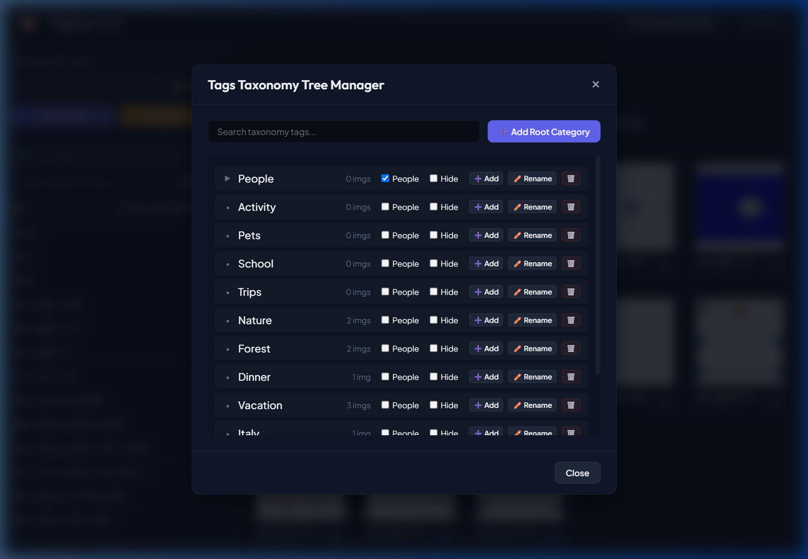
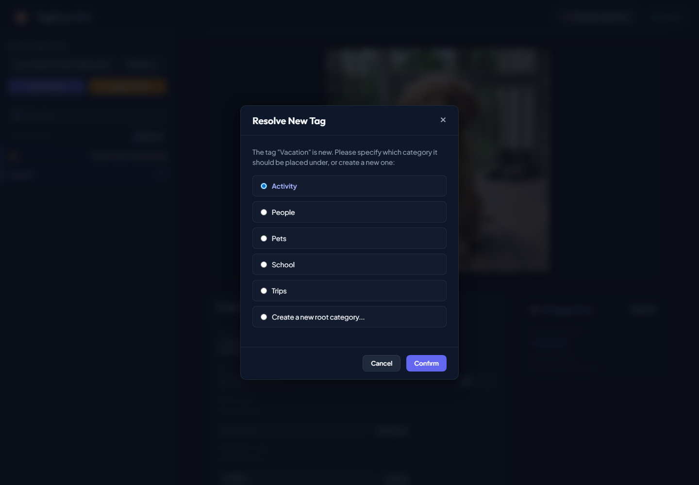
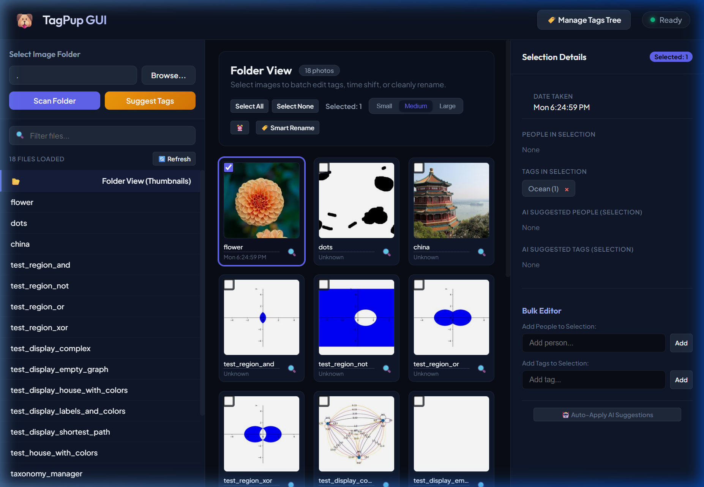

# TagPup GUI — Folder Tagging & Metadata Editor Specification

---
[◀ Back to README](../README.md) | [📖 Tutorial](TUTORIAL.md) | [💡 CLI Examples](EXAMPLE.md) | [🖥️ TagPup GUI Spec](SPEC_TAGPUP_GUI.md) | [🎯 TagTuner UI Spec](SPEC_TAGTUNER.md) | [🐶 CLI Engine Spec](SPEC_TAGPUP_CLI.md) | [🗄️ Database Spec](DATABASE.md)
---

This document records the design, specifications, prerequisites, and instructions for the TagPup Graphical User Interface (Web Workspace) and its matching tag taxonomy mechanics.

## Design and Visual Aesthetics
- **Core Principle**: Dark mode, premium styling with Outfit (headings) and Plus Jakarta Sans (body) typography.
- **Glassmorphism**: Header and modal elements feature subtle transparent background blur (`backdrop-filter: blur(12px)`) with elegant border outlines.
- **Layout**: Flexible layout consisting of a collapsible folder directory tree on the left sidebar, an interactive thumbnail grid in the center, and a multi-select editing metadata details panel on the right.

## Features and Mechanics

### 0. The Tagging Loop

The work TagPup exists for is: look at a photo, tag it, move to the next one. These
behaviours serve that loop and are specified together because they depend on each
other.

**Moving between photos.** `ArrowDown`/`ArrowRight` go forwards, `ArrowUp`/`ArrowLeft`
go back; both pairs do the same thing, because which one a person reaches for depends
on whether they are looking at the list or at the image. Movement stops at either end
rather than wrapping. A horizontal swipe or drag across the main image does the same,
right-to-left for forwards, matching every photo viewer people already use; the
gesture must clear 60px **and** exceed its own vertical movement, so a tap and a
scroll that drifts sideways are both ignored. Modifier combinations are left to the
browser.

**Zoom.** A click on the main image opens it over the whole window, as large as fits
(`object-fit: contain`, a few pixels of margin), for reading the writing on a sign or
a name tag. It loads the original — `/api/photo-file` without `size` — and shows the
800px preview, scaled up, until that arrives; if the browser cannot draw the original
(TIFF, HEIC) the preview stays. A click anywhere on it, or `Escape`, closes it. While
it is open the arrow keys do nothing rather than change the photo underneath. It is
not leaving the photo, so it neither asks about unsaved edits nor makes any. A drag
across the image is a swipe, not a click, and does not open it.

Arrow keys are ignored while the caret is in a field where they mean something to the
text being typed — but **not** in the filter box, which is a search control. A blanket
check on `INPUT` used to catch it and return before `preventDefault`, so the browser
scrolled instead: the keys appeared dead in the one place you most want them, right
after narrowing the list.

**Knowing where you are.** Each sidebar row carries a filled or hollow dot for tagged
or not, and a tag count where it has any. The count line reads `38 of 80 tagged, 42 to
go` rather than `80 files loaded` — on returning to a folder, the question is how much
is left. A photo counts as tagged if it has any tag, any person, or a title: the
question is "have I been here yet", not "is this perfect".

Beside the **Original Image** heading, `12 of 48` says where the open photo sits in
the list. It counts the rows the arrow keys walk — after any search — so the next
photo is always 13 of 48, and a search that narrows the list narrows the count. It
follows every change of photo and every rebuild of the list (search, rename, delete,
rescan), and is hidden with no photo open or when the search has left the open photo
out.

The folder's own name — the last segment of its path, not the whole thing — sits under
the path box and in the window title. The absolute path is long enough to be unreadable
in a sidebar, and the shoot's name is what identifies it.

A checkbox narrowing the list to untagged photos was removed: it added a line of noise
above a list that is read constantly, for a filter reached rarely. Its better home is the
library's: the Keywords navigator's last row, "No tag", and the search picker's "No tag"
(`kind=untagged`, #2837), the photos with no keyword in the library.

Selecting a photo resets the details panel to the top, so each one starts at its own
image rather than mid-panel at the previous photo's scroll position.

**Carrying tags forward.** **Same as previous** (`Ctrl+D`) copies the tags of the
photo above in the list onto the current one. It is additive — tags already present
are kept and only what is missing is added — because replacing would quietly undo work
on a partly tagged photo, which is the one you are most likely to be standing on. It
is offered only when the previous photo has something this one lacks, and the button
says what it would copy and from where.

**Not losing what was typed.** Enter in a field, its Add button, the title's own Save
and a click on a pill still write at once. What is typed and not yet written — text in
the tag or person field, or a title that differs from the photo's — is an **unsaved
edit**, and nothing is ever dropped silently:
- **Save** at the right of the Image Details header writes all of it in one request.
  It is disabled whenever the panel matches the photo: typing and deleting, or putting
  the title back, leaves nothing to save. Its tooltip is `Save (Ctrl+S)`.
- **`Ctrl+S`** (`Cmd+S` on macOS) does the same from anywhere, including from inside
  the field being typed in. It is always kept from the browser, so its Save Page
  dialog never opens.
- **Every way off the photo asks first** — arrow keys, swipe, clicking or pressing
  Enter on another row, the folder view, opening another folder, Refresh: "Save
  changes to `<file>`?" with **Save** (focused; `Enter`), **Discard** and **Cancel**
  (`Escape`). Save moves on only if the write succeeded; on failure you stay, with the
  error and the edit. Discard drops the edit and moves on. Cancel stays with the edit
  intact.
- Closing or reloading the tab with an unsaved edit raises the browser's own prompt.
- A typed name must resolve before anything is written. One whose placement is not
  settled (a placement question cancelled) stops the save and stays in the field.
  Names the photo already carries are not written again — compared the way the rest of
  the app compares them (`photoAlreadyHas`, so a person matches by name).

Leaving a field no longer commits it. It used to, and that lost the tag anyway: the
commit resolved the name first — a round trip for a pathed tag or a new person — and
clicking the next photo blurs the field on mousedown and navigates on click, long
before that returns. By then the field had been cleared for the next photo, and the
save found nothing. The prompt replaced it.

`Escape` in the tag or person field empties it; in the title field it puts back the
photo's title.

### 0.2 What the analysis found

Below the photo's details sit two halves of one row: **AI Suggestions** on the left,
**Detected Faces** on the right. Suggestions lead because they are the thing to act on;
the faces are reference, and the place to pick up a match the suggester was not
confident enough to propose. Either half takes the full width when the other is empty.

Clicking a face adds that person to the photo — a recognised one as readily as a
proposed one. Only unnamed faces carrying a suggestion used to be clickable, so a photo
whose faces were already identified offered no way to act on them: the strip said who
was in the picture while People Tags sat empty. A face whose person the photo already
names is dimmed and says so rather than looking live and doing nothing, and an excluded
face is never offered.

The suggestions box lists **only what the photo does not already carry**. It previously
listed everything the analysis produced, so after Apply All it sat there repeating back
the tags it had just written; a suggestion you have taken is a tag, and it is shown as
one a few inches above. Taking one removes it, and when nothing is left the box goes
away rather than becoming a heading over two empty lists. A person is matched by who
they are, so a bare suggested name counts as present on a photo tagged with their path.

A photo with nothing to offer yet says why in one line (`role=status`), from the folder's
last `suggest-status` poll (owner, 2026-11-05): while the folder's run waits or is under
way, the server's own `message` as it is sent (waiting for the folder's index, or for the
graphics card and who has it), else `Suggesting... 2 / 3`; the line is replaced by the
photo's chips when its suggestions arrive. After a run, a photo it could not read says the
run's error and "Start Photo Analysis again to retry", and that button stays enabled while
any photo of the folder has failed. A photo never analysed with no run under way says
nothing: the box stays hidden. A reply for a folder no longer open, or arriving after the
library view opened, shows nothing; a run started in another tab is seen when the folder
is opened again.

### 0.1 Feedback, Scope and Undo

**One status channel.** Results and validation go to the status line, which was
already carrying them. Modals are kept for exactly two cases: a question that must be
answered before acting, and a failure that would otherwise pass unnoticed. Success
confirmations were removed — stopping the work to report that the work worked is
worst precisely during bulk operations, when you are moving fastest. Validation
messages appear beside the field they are about, which is marked, rather than in a box
that hides the form you need to correct.

**Scope before irreversible writes.** Auto-apply states how many photos it will write
to, how many of those already carry tags, that suggestions are added rather than
replacing, and that it writes into the photo files. The common mistake is not
misreading the button — it is having the wrong selection, which a bare count does not
surface. Camera time-shift states the number of photos affected, resolving
`All Cameras` to a real count, and says whether it can be undone: from History for a
folder the library holds (it is one journaled change, "time shift"), and plainly that it
**cannot be undone** from here while just looking, when nothing is journaled. A folder of
clips only has no photo to shift (a clip's Date Taken is not changed), and says so
without asking.

**Undo.** One step deep, covering the last bulk tag write (`Ctrl+Z`). Photos are
restored from a snapshot of the tags and title they had before the write, rather than
by reversing the change field by field: a snapshot cannot be confused about what an
addition or a removal was. It is one step on purpose — the mistake it catches is a
bulk write against the wrong selection, noticed immediately, and a deeper stack would
imply a guarantee this cannot make, since the photo files are the source of truth and
anything can edit them behind the app's back. A partial restore says so.

**Keyboard reachability.** Sidebar rows are focusable and carry `role="option"`;
`Enter` or `Space` opens the focused row, and focus is visible. Previously nothing in
the list was focusable, which is why the arrow keys worked only while focus happened
to be sitting on `<body>`.

### Activity

**Activity...** in the gear opens the Activity page in a new tab, at `/activity/` -- one page for the background work of every library in the data folder, served by both apps alike, and to this PC only (`web/activity/`, over `/api/activity/`). Its sections:

- **Now**, asked again every three seconds while the tab is in view and not while it is hidden: a card for each library, its runs as a tree -- an index under the run that queued it (its `parent`; this process's own index under the run its row's `parent` names) -- each with its phase in the server's words (`said`), how far, the percent in words beside the bar, how long it has run and since it last moved; the folder watcher's whole sync is one line with the library's running sync, at the folder its walk is at. A run whose last progress is more than five minutes old is **stuck** ("no progress for 12 min; the share may be away"), as the server's `state` says (the page holds no copy of the rule); one that has said nothing yet is not. A library with nothing running says so, and what finished last ("Nothing is running. The last, sync, finished 2 h ago."); one whose jobs cannot be read says why on its card. Beside the runs, the folders waiting, its Suggest runs and its batches of photo files; and the server, draining while it moves onto a new version. One line above them, read aloud as it changes (`aria-live`), says what runs and how far in tens of percent, so a poll that changes only seconds says nothing.
- **Needs you**: each failure that asks the owner to act (`needs_you` of `/api/activity/jobs`), a block each: what happened (the run's sentence), what it means (its kind's), what to do (the next step) and how often (once, or how many times since when); **Run it now**, asked first, only where the server says the job has it (`run_now`), its answer shown there and not in Scheduled jobs; "Nothing needs you." when nothing does. Drawn again only when what it shows changes.
- **Scheduled jobs**: each job with why it is scheduled (`safety`, `catch-up`) and, for each library, its last run -- when, how long, how it ended, what it changed as counts, why it failed -- and when it is due; **Run now**, asked first; its last runs, unfolded; a failed last run flagged until a later one is done. **Logs for this run** shows the lines the run logged.
- **Sync & watcher**: each library's root folders (on disk or missing, watched), when a change was last noticed, its last sync of one folder and of the whole library ("last in step"), and the folders to review, opening TagTuner's dialog.
- **Snapshots**: each library's, with kind, age and size, and the disk they take.
- **Server**: the version answering, running since and the background tasks; and the models -- what is loaded (CLIP, faces, or "Not loaded; loads when Suggest or indexing needs it"), since when last used, and **Unload models now**, which lets them go and gives the graphics card up at once (disabled when nothing is loaded; while a run is using them it does nothing and names it: "In use by Suggest Regatta (harbour): they are let go when it ends.", or the startup warm-up while it loads). The server lets them go by itself after 5 idle minutes, and loads none at start.
- **Recent activity**: one timeline of what was done -- changes of the journal, job runs, syncs, runs of the indexer, updates -- newest first, with their counts; **More** reads further back.
- **Logs**: the logs in `data/logs` in two lists, as the server groups them: **The programs' own logs** (the web server's, its console's, the MCP server's: a short list, the web server's shown first) and **Runs' logs** (each run of the indexer, each failed test run), the last 5 of each library and kind kept ("The last 5 runs' logs of each library and kind are kept."), filtered by **Library** and **Kind** (All unless asked; a filter matching nothing says so: "No indexer runs' logs of lighthouse are kept."; a test run belongs to no library, so Library is set aside, greyed, while Kind is Test runs). Each log is said in words -- what ran, its library and when, when it was last written and its size -- its file's name only its tooltip; the one shown is drawn bold with a thicker border. The log shown, newest lines first, each as time, level, logger and message, filtered by level (INFO and worse unless asked) and by text; **Follow** asks for new lines every three seconds; **Older** reads further back; **Raw** shows the end of the file as written, **Download** saves it. A log that is not there -- a run's removed with the older ones, or a run that has written none yet -- is said where its lines would be, in the server's sentence ("This run has written no log of its own (yet)."), whether the read, **Older** or **Follow** found it gone (Follow then stops, and the section does not say it could not be refreshed: the server answered), and Raw and Download are not offered for it. A click on another log while the listing for **Logs for this run** is still on its way is the one shown; the log button pressed keeps the keyboard's focus.

Scheduled jobs, Snapshots, Server and Logs are folded until opened, each showing one line while folded: the next run due and how many failed last time; the last snapshot and the disk they take; the version and how long it has run; how many system logs and how many runs' logs are kept ("2 system logs; 3 runs' logs kept"). The browser remembers which are open (where it may: otherwise each opens folded), and a link of the page's top line, or **Logs for this run**, opens the section it goes to. A poll that is not answered (or answered `success: false`) asks half as often each time, down to once a minute; Now's says so in the top line ("The server did not answer; asking again at 15:31:08."), each other section's under its own heading ("Snapshots could not be refreshed; asking again at 15:31:08."), and each poll's next answer clears its own line and puts it back on time, whatever the others still wait for. An error drawing an answer is not the server's: it is logged and the section asked again on time. Follow reads nothing while Logs is folded. Run now's read of the jobs after its answer is the jobs' own poll, at once or once the read in flight is answered.

### 1. Folder Browser & Grid Selection
- **Which library**: the header names the library the page works in, beside the logo, at all times: every change on the page goes to it (`web/tagpup/membership.js`, from the page's address).
- **Choosing a dog park**: the database picker is labelled *Dog Park* — it holds one library's photos, people, tags and suggestions. It is free to change until a folder is open, and locked behind a **Change** button afterwards: switching reloads the page carrying the same `?path=`, so the same folder would come back attached to a different index with nothing marking the change. Change closes the folder and drops it from the URL, so the new dog park starts from a deliberate choice. The picker's list is the page's own listbox (`web/common/library-picker.js`, #909: a native list showed a blank block under its last option that no style reaches), its native `<select>` kept hidden as the one place the choice lives; `scripts/measure_select_list.py --run --listbox` measures it in a real browser. Every other drop-down list of the pages is drawn dark by one stylesheet, `web/common/dark-select.css`, that each page links (#782); a page's own styles never set a list's scheme or an option's colour (`tests/test_dark_selects.py`), and `scripts/measure_select_list.py` photographs an open native list in a real browser.
- **Adding a folder to a library**: only when asked. Opening a folder asks the library what it holds of it (`/api/folder/membership`); when photos under it are in folders the library holds none of, a dialog asks first, the library's name prominent: **Add this folder to kr-track?** (or **Add the rest of this folder**, when it holds some), with the folder, its photos, **Outside kr-track's root folders** when so, **kr-track's settings ignore this folder** when so. It names only the library the page is in; no other library is opened, read or named (2026-10-02). **Add to kr-track** adds it (`/api/folder/add`: recorded as added, so it is the library's at once, and indexed, the progress shown here) and the page works as for any folder; **Just look** (and Escape) shows its photos and lets the owner edit their files -- captions, tags and people (one photo or many), Smart Rename, rotating, deleting, Date Taken and Time Shift are written to the photo files only, not to the library -- and runs **Suggest**, which analyses the photos against what the library already knows (its photo vectors, its named faces, its tag tree: all read) and keeps what it finds in the server's memory only -- nothing is added to the library; Apply All, a suggestion's chip, the title wand and carrying tags forward (Ctrl+D) write the files only. Only **face naming** is held back (the faces strip dimmed, its clicks stopped) because naming a face makes a person record in the library. A note says so: "Just looking: kr-track does not hold this folder. Tags, captions, renames, rotating, deleting and date changes are made to the photo files only, not to kr-track. Suggest analyses the photos against kr-track without adding them; nothing is saved to kr-track. Face naming is off until you add the folder.", with an **Add to kr-track** of its own. When such a run finishes the status line says "Analysed against kr-track; nothing was added to kr-track." and what the library had too little of to compare with (a new library: "has no photo vectors yet", "has no named faces yet"). A new tag or person typed there is written to the file as typed and filed, and no node is made in the library's tag tree. After a write the status says where it went ("Written to the files only: kr-track does not hold this folder", or "1 to the files only (kr-track does not hold their folder), 2 with their rows"); a delete there says the file went to the Recycle Bin (through this PC's, from a share) and nothing in kr-track changed. The folder just looked at is not asked about again while it stays open. Whether a Suggest only looks is the server's answer at its start (`/api/folder/suggest-start`), never a flag from the page. TagTuner's Add Folder adds through the same service. Keywords TagPup writes are recorded in the index as it writes them, so there is nothing to press afterwards.
- **Opening a folder**: Choosing one opens it. Browse, picking from the autocomplete list, pressing Enter, or leaving the path box all scan immediately; there is no separate Scan Folder step, because choosing a folder and asking to see it were never two decisions. Re-committing the folder already open does nothing, so blurring the box does not rescan. **Refresh** on the open folder syncs it first (`POST /api/sync` with the `folder`, applied: the rows follow the files, and a file found gone starts the whole sync that removes it; plan folder-refresh-syncs-the-folder), then re-reads it from disk once, and the status line says one sentence from the reply (`library-view.js` `folderRefreshSaid`): what was new (files of folders queued for indexing; those of a folder waiting for review are said apart), changed, moved or gone and whether the full check was started, "This folder is in step." only when the reply says `in_step` (else that it is not fully in step yet), another check under way, the refusal (a Just-look folder outside the roots: calmly, nothing to sync), or that it could not check (the list is read all the same); the list read after the sync is the folder synced, whatever was typed meanwhile. "Checking this folder..." while it is out, and presses meanwhile send nothing; unsaved edits are asked about first; an answer for a folder no longer open is dropped. In a library view, **Refresh view** reads the view's order again.
- **Views of the library** *(phase 9b-2)*: the gear's **Browse the whole library** shows every photo of the library, by Date Taken, in the grid a folder uses, from the library's index (no folder is read); **Library view of this folder** (greyed with no folder open) shows the library's photos of the open folder and its subfolders. The address names the view -- `?view=<all|folder|keyword|person|year|month>&value=<value>[&recursive=1][&order=...][&media=<photo|video>]` (a folder by its path, a keyword by its tag, a person by name, a year as 2024, a month as 2024-06) -- so Back, Forward and a bookmark work; a `?view` wins over a `?path`, and an address that names no view (an unknown kind, no value, a year that is not one) opens an empty view that says so in a sentence. One floating header above the grid (#713) says which view is open and how many photos and videos it holds (as the server counted them: "9 photos, 3 videos", #2569) and holds the view's controls, always at hand while the grid scrolls: **Refresh view** (an icon button), **Sort by** (#714: a menu of two sections, the field -- Date Taken, Caption, File name -- and the direction -- Ascending, Descending --, each a radio group showing the current choice; arrow keys, Enter, Escape; the address keeps the order as `order`, and the next view opened is read in it), **Show** (beside it, the same kind of menu: Both, Photos or Videos -- the view's photos and videos, or one kind alone; lit while it shows one kind; the address keeps it as `media=photo` or `media=video`, the next view opened shows the same, and a Select all, and so a bulk edit or a Delete of it, is of what it shows; the count says how many the source holds of either kind beside its own, "3 videos (of 1,204)", and a view it empties says why, "No videos here: the 1,204 in this view are all photos. Choose Both to see them."; a page loaded or reloaded, and another dog park, open on Both, while Back and Forward within the page return each view with its own), Select All, Select None, Delete, the selection's count and the thumbnails' size; a card the arrow keys walk to is kept below it. Organize's header is the folder's own, and does not float. (The strip's "Back to folder view" went with #670: Back, the navigator's Organize or a folder of the selection's **Folders to Organize** leave a view; that folder opens with the sidebar's switch on **Organize**, #712.) Only the cards near the window are fetched (`/api/library/cards`) and drawn, the others are placeholders; the order is read once (`/api/library/ids`) and is not recomputed until **Refresh view**, which keeps the place near the same photo: a photo edited, deleted or renamed updates its card in place, a deleted one goes and the total drops. Selecting is by photo id (see "Editing the selection of a library view", phase 9d-2), instant over cards not yet fetched. The details panel opens the photo whole (`/api/library/photo`) and edits it by path as in a folder; its Previous and Next follow the view's order. *(#780)* A photo opened over a view -- the card's magnifying glass, Enter on a card -- has a **← Back to the view** button above its picture, and **Escape** and the browser's **Back** do the same: the view comes back exactly as it was left, the grid at the same place (the photo that was at the top is at the top; if photos went meanwhile, the nearest place), the same photos selected (a Select all with photos left out too), the same order, the same address, and the navigator's open rows and the search box's words and chips as they were. The photo is one place in the browser's history however many photos are stepped through (Forward opens the photo it was on again), so Back never leaves the page. Back with unsaved edits in the photo asks first; Cancel keeps the photo. When the open photo is deleted the next opens, and Back shows the view without it and the selection less it; when a bulk Delete takes the open photo the grid comes back at once. Opening another view over the photo (a navigator row, a People or Keyword jump, a search) forgets the place: it is the first view's. After a reload the view comes from its address and the grid is found where it was scrolled to by a Back, best-effort; the selection is not kept. While a view is open the folder's own machinery is idle: no scan, no add-folder question, no Suggest, no sidebar list, no file filter (the library is searched from the Library pane's search box, below), no Smart Rename or Camera Time Shift, and nothing is kept in this browser's folder cache. Choosing another dog park drops the view.
- **The navigator, and the move between a folder and its view of the library** *(phase 9c)*: the sidebar is two panes behind a switch at its top, **Library** and **Organize** (called **Folder** until #668, when it was mistaken for the library's Folders tab). **Organize** is the work on one folder on disk, what it always was (the folder box, Suggest, the open folder's file list, Smart Rename, Camera Time Shift); **Library** is the navigator, four tabs -- **Folders**, **Keywords**, **People**, **Dates** -- each a filter box and a tree or list of what the library holds with the photos counted (`/api/library/navigator`, read when a tab is first opened, and again a moment after a write that finished and at once on **Refresh view**; a section that cannot be read says why in the server's own sentence, a library with none says there is nothing). Folders and Keywords are lazy trees (only what is open is drawn, at most 1,500 rows, and a line says how many were left out; the keyword tree is alphabetical), People an alphabetical list, Dates the years newest first opening to January..December, with the years the route calls implausible (before 1900 or after next year, #510; photo_index holds 1827 to 2079, from a number in a file name or a scan's clock) gathered under one collapsed **Other years (N)**. A click on a row opens the library view of it (a folder with its subfolders; a keyword and everything under it) and the row of the view that is open is highlighted, in the tab it belongs to, opened to it -- also when the page is opened by its address, and by Back and Forward. **Several rows at once** *(the owner's review, #672)*, in every tab: a click selects a row and every row under it (shown selected); Ctrl-click adds or takes away a row (and the rows under it); Shift-click selects the rows drawn from the last one picked (Ctrl+Shift adds them); Ctrl+A every row drawn; Space, Ctrl+Space and Shift+Space do the same from the keys. The grid is the union of the rows selected, each photo once: a row with a row under it taken off keeps its own photos (a folder's own, a keyword alone, a year's "Other"). The address holds it (`?view=any_of&value=<the sources, as JSON>`), so Back, Forward and a bookmark restore it; a selection whose address would be longer than 100,000 characters (the server reads at most 262,144 bytes of a request's first line and headers, so it could never be reloaded) is a sentence and opens nothing -- about 1,000 short rows, 400 of a network share's long folder paths. In a library view the Library pane is shown and in a folder view the Organize pane, until the person chooses the other (remembered until the page is left). The trees and tabs follow the ARIA patterns: one tab stop, arrow keys, Right and Left to open and close, Enter to open the view; Left and Right move between tabs. **Show in library** (beside Select All, with a folder open on disk) opens the same folder's library view with its subfolders and lands on the photo that was at the top; a folder of the selection's **Folders to Organize** opens that folder in Organize -- scanning it first, so that a folder that is not there any more, or a share that is away, leaves the view open and says so in its strip --, the selection cleared by either. The strip of a folder's view had **Show on disk** and **This folder only** / **With subfolders** until #670, when the owner found them not needed; an address with `recursive` absent still opens a folder's view of the folder alone. When the disk holds photos the library does not, a banner under the strip of a folder's view says "N photos in this folder are not in kr-track." with **Add them** (the same add-folder question a folder opened asks, with **Not now** for Just look; nothing is indexed until it is answered) and **Dismiss**; it is asked after the view has painted (`/api/folder/membership`, an answer later than 15 seconds is not wanted), by itself only for a view of this folder only or one with subfolders of under 1,000 photos (a larger one is asked by **Refresh view**, whose tooltip says so; the link "Check this folder on disk for new photos" that asked it was removed as one button too many, the owner, 2026-11-13), and kept for the page until Refresh view, an Add or a change in when the library was last in step; a share that is away, a folder that is gone or a library that cannot say shows nothing. The strip says when the library was last in step with its folders (`/api/sync`) **only when something is wrong** (#670): "Could not read when the library was last in step with its folders.", "A sync is running now. Last in step with its folders: 5 min ago.", "Never in step with its folders: no sync of the whole library has finished.", "The last sync found photos not in step with the library yet. Last in step ...", "Last in step with its folders: 3 days ago." (more than 48 hours), or, beside the banner of photos on disk the library does not hold, "Last in step with its folders: 5 min ago."; an in-step library says nothing. A card whose file changed since the library read it is marked **changed on disk** and one whose file is gone **missing** (`/api/library/cards` looks at each file once; a share that does not answer gives no mark); a missing photo opens with a notice and cannot be edited (its write controls are inert), a changed one is read from its file when opened and its mark clears. The grid is one tab stop: Tab reaches the card the keys are on, the arrow keys move one card or one row, Home and End to the first and last photo, PageUp and PageDown a window, Enter opens the photo, Space selects it, Shift with an arrow or Space extends the selection from where it began; the card is an option of the grid's listbox, named by its file name, date, whether it is selected and whether it is changed or missing; the window's edge and 20,000 photos are no obstacle, and the focused card stays in the page while it has the focus.
- **Search** *(phase 9e-2)*: at the top of the **Library** pane, as Windows Live Photo Gallery's: words in one box -- captions, tags,
  people's names, file and folder names, each word found as the start of a word (and, from three characters, inside a file or
  folder name; a four-digit word is also the year a photo was taken) -- searched on **Enter** or **Search**, not as they are typed. **Filters** opens three lists, **All of**, **Any of** and
  **None of**, each of chips of the library's tags and people picked by a box that completes as it is typed (the navigator's own
  names: a person by their tag, shown by their name, a tag by its path; a branch of people is a tag, never a person): arrow keys, Enter to add, Escape to
  close, Backspace on an empty box to take the last chip off, a chip's x to take it off. A chip added or taken off searches at
  once. While rows of the navigator are the view open, **Within the sidebar's selection** under the box searches only their
  photos (then shown as a chip "Within ..." of All of). The result opens in the grid as any view, with the same header, Sort by,
  selection, tally, bulk edits and Delete; the address holds it (`?view=search&value=<the search as JSON>&order=`), so Back,
  Forward and a bookmark restore it with the box's words and chips. Changing an open search replaces it in the history: Back,
  and the box's **x** (Clear), return to the view before the search. A list holds at most 1,000; a search whose address would be
  longer than 100,000 characters, or words of no letter or digit, are a sentence by the box and nothing is sent; a chip of a
  tag or person the library no longer has (a bookmark, a rename) is struck through and says so; a search the server refuses
  says its sentence by the box. A search with no result says "Nothing in the library matches this search."
- **Editing the selection of a library view** *(phase 9d-2)*: a library view's selection is the photos' ids, not their paths -- the ones picked, or the view's whole source but the ones left out -- so **Select all** of 68,000 photos is instant and asks nothing, a **Shift**-click or Shift+arrows select the range between by the view's order whether or not its cards were fetched, and **Invert** swaps what is selected with what is not (up to 20,000 either way; past that it says "Too many to invert: use Select all and deselect"); stepping a Shift+arrow back toward where the run began takes the photos off again. The selection is kept by Refresh view and by edits, and cleared when another view opens. The **Selection Details** panel counts what the selected photos carry -- the tags and people, each with how many photos hold it, alphabetical, "N more" past 500 -- on the server (`/api/library/selection/tally`), a moment after the selection stops changing ("counting..." meanwhile). Under **Folders to Organize** it names the folders the selected photos are in, by their own names (two of one name with the folder above them), each with how many of its photos are selected, when there are 10 or fewer: a click opens that folder in Organize (scanned first; a folder gone or a share away keeps the view and says so in its strip). More than 10 is one sentence: "These photos are in 2,672 folders. Narrow the selection to 10 folders or fewer to open one in Organize." A view's panel has no Date Taken (#675); Organize's has, and has no Folders to Organize. *(#781)* The panel of a library view is in two halves. **Navigation**, above: Folders to Organize (as above), **People jump** -- each person the selected photos carry, a link that opens the People view of that person, with how many of the selected photos carry them -- and **Keyword jump** -- each keyword a link that opens the Keywords view of that tag (the tag and everything under it), leaving out the people (the server leaves a person's own tag out of the tags before it cuts them at 500, so "N more, not listed" is the keywords really cut) and a folder the panel offers to Organize. A name the tag tree has no single person node for -- a branch, two nodes, none -- is listed under People jump without a link. A link's address carries the navigator's order, so a Ctrl-click opens what a click does. Lists are alphabetical, as the chips are; past 12 a list shows its first 12 and a button, "and 8 more", that shows the rest ("Show fewer" puts them back). A link is a link (it has an address, and a Ctrl-click opens it in a new tab); a plain click changes the view as a click on the sidebar's row does -- the address names it, Back returns, the navigator shows it selected -- and leaves the selection behind, as every opened view does: it has its own. **Tagging**, below, is a section with a disclosure button (`aria-expanded`, `aria-controls`) that starts closed, whose choice this browser remembers (`tagpup.selectionTagging`); it holds the people and tags of the selection with their arrow and ×, and **Add person** and **Add tag**, as below. Suggest's auto-apply is not in a library view. Organize's panel is not split: its tagging is always open, beside Date Taken and auto-apply. **Add person**, **Add tag**, and the **×** and the arrow of a tag or person in that panel each ask first -- "Add Trips/Lighthouse to 3,412 photos? This changes the photo files and takes about 4 minutes. History lists it as one change and can undo it." -- and then write the selection in **one request** (`/api/library/bulk-edit`) that answers when every photo is done: at most **5,000 photos** (about a twentieth of a second each, so up to some minutes), and the view's edit controls are off while it waits. The status line reads "Add Trips/Lighthouse to 3,412 photos..." and **the batch strip** (bottom left, over any dialog; the same on TagTuner) shows how far the server has got, from its own counts: "writing 3,412 photos (bulk tags)", a bar, "1,200 of 3,412, about 3 minutes left" (from when it started and what it has done), and **Cancel** (the batch stops after its chunk of 25; what it wrote is kept and History can undo it); a batch waiting behind another says "Waiting, 1 ahead". A reload shows a batch still going, and a second tab shows the same one. It ends in one sentence in the strip and the status line ("Added Trips/Lighthouse to 3,380 photos; 32 missing on disk were skipped; 0 errors.") with the first 50 errors and their file names, a **History** button and **Dismiss**; a batch stopped as asked ends in the server's sentence ("Stopped as asked after 25 of 60 photos: 25 file(s) were written, recorded as change 7 in History, which can be undone; the rest were not written."). When the strip cannot ask the server how far it has got it says "TagPup cannot tell how far the write has got" and never that the write finished. An answer that does not come (the connection dropped, the server restarted) is said with what to do ("The edit may still be being written, or may be written already: look at the photos before making it again") and is not sent again, since an edit made again changes nothing a photo holds already but a Delete asks its question afresh. **Smart Rename and Shift Date Taken are not offered in a library view** (#669, the owner's review): they are work on one folder, in Organize. The server's bulk time shift is gone (2026-10-11: nothing started it, and the resume it needed was the most code of the job); Organize shifts one folder's photos. **Delete** beside Select None (a view's, #674, and Organize's, for the open folder's selection by path: see Multiselect actions) deletes the selection: it first asks the server where the files would go (`/api/library/selection/delete-check`, "Looking where the files of N photos are..."), then asks "Delete 3,412 photos? The files go to the Recycle Bin, where they can be restored. Their rows leave the library, with their faces. It takes about 4 minutes; TagPup is busy until it is done, and saving a photo elsewhere waits for the photos being deleted at that moment. It cannot be undone in TagPup." -- or, where some have no Recycle Bin, "1,200 of them are where there is no Recycle Bin (1,200 on a network share): they are copied to this PC (2,345 MB), the copies go to this PC's Recycle Bin, and then the originals are deleted. Restored from the Recycle Bin, a copy goes to C:\\Users\\...\\Downloads\\TagPup deleted from shares, not back to where it was. The other 2,212 go to the Recycle Bin." -- with how long it takes (at 15 photos a second, measured) and that saving a photo elsewhere waits for the photos being deleted at that moment; when the copies cannot be made here at all (Downloads under OneDrive, not room on its drive, a Recycle Bin Windows cannot tell of) it says so and asks nothing; when this PC's Recycle Bin would not keep them (full, set to delete at once, or smaller than one) they are among the files deleted for good below, and when it is full the second question begins "The Recycle Bin is full: delete permanently instead?" (the delete-check's `bin_full`; owner, 2026-11-12); the question names the server's count of the photos, which the request's token is of; when some are on a drive whose own Recycle Bin would not keep them (the delete-check's `for_good`), a second question names them ("These files would be deleted for good, not moved to the Recycle Bin: ...", the first 5 file names and "and N more"; "OK deletes them for good; Cancel deletes nothing.") and only OK sends `for_good`, Cancel starting nothing; it is written in one request of op `delete` and ends in the strip ("Deleted 3,412 photos to the Recycle Bin; 0 errors.", "..., 2 of them for good" when some were, never a Recycle Bin when all were); a clip the details panel plays that is among the selection is stopped before the request is sent, and plays again if it was not deleted (a clip opened while the delete is out plays, unless its own file is under delete: the server refuses that one, `/api/video-file`); when it is done the view's order is read again, so the deleted photos leave the view, its total and the selection, and a photo open in the details panel that was deleted is closed onto the grid (in Organize the folder is read again instead: see Multiselect actions). A selection over 5,000 photos is refused before anything is asked of the server, with "Select up to 5,000 photos at a time (N are selected).", also beside the panel the moment the selection is so (owner, 2026-10-11). Only one bulk edit or delete is written from a page at a time, the panel's one-photo Delete counted: while one is, the edit controls, a view's and a folder's, and the sidebar's Refresh are disabled with a tooltip, and the panel's Delete says "A bulk edit is being written (see the strip at the top). Wait for it to finish." (while the panel's own delete is out, the selection's says "A photo is being deleted; wait for it to finish.", also when the panel's began while the selection's question was open: it is said, in the status line too, and nothing is sent); the server writes one batch at a time and queues eight, and the next request shows its sentence (`409`, "9 photo batches are ahead of this one"). The edit goes on to its end on the server when the tab is closed, the view changes or the page is reloaded; its result is not shown again (History lists what was written). The Activity page lists no bulk edit now; the runs an older version recorded there are still listed. Ctrl+D stays off in a view; a folder's own selection, bulk tags, Smart Rename and Camera Time Shift are as they were, in Organize.
- **Directory Tree**: Scans image folders and lists subfolders grouped chronologically by capture year. Folder structures start collapsed on page boot.
- **Thumbnails sizes**: Segment buttons dynamically switch card sizes between **Small**, **Medium**, and **Large**.
- **Multiselect actions**: Standard checkbox check toggles and range select (Shift-Click) select contiguous items in the list. **Delete** beside Select None is shown while something of the open folder is selected, and deletes the selected photos and clips as a library view's Delete does (above: the question naming the server's count, the token, the Recycle Bin rules, the strip, Cancel), the selection sent by path (`{"paths": [...]}`); a selected file the library holds no row of (copied in, not indexed yet) is said in the question and left where it is. Tag changes still waiting for a selected photo refuse it with a sentence before anything is asked, and typed edits of the open photo, when it is selected, are asked about first (Cancel stops the delete). When it ends, or stops part-way, the folder is read again: the deleted leave its list, its kept scan and the selection, what stayed (a share that did not answer, a file in use) stays listed and selected, and a photo open in the panel that was deleted closes onto the next one the folder still lists (else the one before it); a clip stopped for the delete plays again only when the folder still lists it. A folder or a view opened while it runs is left as it is (#532). In a folder looked at without adding it (Just look) the button is shown inert: its tooltip, and a click, say "<library> does not hold this folder: delete one photo at a time with the panel's Delete", and nothing is sent.
- **A folder opened again shows what was written** *(plan photos-written, owner 2026-11-22)*: a folder's scan is kept in the browser for half an hour, and every write the page makes reaches every kept scan of this library that holds the photo (its own folder's and every folder above it), not only the open grid: a tag change, a Time Shift, a save of one photo (its Date Taken too), a turn, Smart Rename of one photo or a folder, a Convert. A single save's new Date Taken moves the photo at once to its place in the open grid, as a Time Shift does, and in every kept scan. A Delete forgets every kept scan holding the photo. A reload, or another library chosen, while a write is out forgets the kept scans of the photos it names, so the folder is scanned when opened again.
- **A narrow window** *(owner, 2026-10-08; findings #720)*: under 1,100 px wide the **Selection Details** panel is not beside the grid: a **Details** button beside Select All (`aria-expanded`, `aria-controls`) brings it over the grid's right edge, where its own **x** closes it (it covers the Details button); the panel starts closed, and this browser remembers the choice (`tagpup.detailsPanel`, kept in a try/catch: a browser that keeps nothing still works). Over 1,100 px the panel is beside the grid as ever and there is no button. At 1,600, 1,000 and 720 px the page has no horizontal scroll, collapsed or opened, and a card is at least 150 px wide (measured in Chromium; the header's library name gives way with an ellipsis). 1,100 and not 1,000: below about 1,060 the grid cannot hold two cards between the sidebar (360 px) and the panel (340 px).

### 2. Smart Renaming & Eviction
- Sequential renaming based on a custom `[Grouping] - [Index] - [Caption]` format.
- Evicts conflicts automatically to temporary filenames.
- Preserves the original filename in `XMP-xmpMM:PreservedFileName` metadata.
- **Where the photo is, and what it is** (Image Details, `web/tagpup/photo-path.js`, `photo.js showPhoto`): the folder's name and the photo's, each cut with an ellipsis and whole in its tooltip. The folder's name opens that folder (with its subfolders) as a view of the library the page is on, or goes back to its grid when that view is the one the photo was opened from; the photo's name opens it in the default app (`/api/photo/open`); a copy button copies the whole path as the record spells it, and says so when the browser will not let the page copy. Beside them, labelled lines: `Date taken:` read whole from the stored digits (`3/27/21 12:00 AM`, never through a `Date`; `Unknown` for none), `Size:` (a photo's and a clip's alike), and `Camera:` only when the file names a camera or lens.
- **Smart Rename of one photo**: beside the open photo's file name, a grouping box filled from its name (`/api/photo/smart-rename-parts`) and editable, with a button that renames that photo alone in the library's format (`/api/photo/smart-rename`, `web/tagpup/rename-one.js`): the photo keeps its number, a name with none takes the folder's next, and a name another photo holds is refused, not taken.

### 3. Tag Taxonomy Tree Manager
- Open the hierarchical tree modal from the gear at the right of the top bar: **Tag editor**. The editor is one module both pages open (`web/common/tag-editor.js`), and TagTuner's gear opens the same one; its routes are served by both apps.
- **Settings** in the gear opens the library's settings for TagPup's own features -- Suggest's candidate words and Smart Rename's format -- in the same dialog TagTuner's gear opens for the photo model, the face model and ExifTool (`web/common/settings-dialog.js`, over `/api/settings`, which answers each app its own groups). Neither is locked: a change applies from the next Suggest or rename, and is journaled, so it is in the library's history and can be undone.
- **History...** in the gear lists the library's last changes -- each bulk edit, file write, save and settings change, newest first, with when and how many rows and files -- and offers **Undo** beside each that can be undone (`web/common/history-dialog.js`, over `/api/history`). Undo rehearses first and says what would be put back and what refused; **Confirm undo** makes it. A photo file changed since is refused, named by photo id, never overwritten. After an undo that changed photos the folder is scanned again. The same dialog is in TagTuner's gear.
- **Name faces from tags (whole library)...** in the gear opens the same dialog on the whole library, with no folder step, whatever is open; TagTuner's gear has the same item.
- **Manage folders...** in the gear opens one dialog, `web/common/folder-manager.js`, that both pages open: add folders to the library (browse to a parent, tick its subfolders, queue them to be indexed) or remove a folder the library holds (the removal half below, "Remove"). TagPup follows a queue that holds its open folder, or one above it, to the end of its index.
- **Activity...** in the gear opens the Activity page in a new tab: the background work of every library (below, "Activity").
- The gear's last item, **Open in TagTuner**, opens TagTuner on the same library in a new tab (its address from `/api/apps`). The menu opens on click, Enter or Space; the arrow keys move through it, Escape closes it and puts the focus back on the gear, and a click anywhere else closes it. Below its items the gear says which version of TagPup answers (`/api/server`, asked at each opening), not an item itself.
- While a launch or an install moves the server onto a new version, a request the server turns away (503, `X-TagPup-Updating`) is sent again after its `Retry-After`, and again while nothing answers during the restart, for up to two minutes (`web/common/api.js`): the page waits out the update rather than showing an error. A page left open while its server was replaced by another version (a launch of a newer one, `tagpup.launcher`) says so in the banner at the top -- "TagPup was updated while this page was open. Reload this page to use it" -- at the first response naming the new version (`X-TagPup-Version`), and runs the version it was opened with until reloaded: a reload would lose an unsaved edit.
- Lists categories in a tree starting collapsed by default. **Every level is in alphabetical order**, roots included: case and accents ignored, digits read as numbers ("Trip 3" before "Trip 10"), ties broken by the exact spelling and then the id (`compareTagNames`, `web/common/vocabulary.js`). It is the display's order only; the stored order and the server's are not changed, and the delete question lists the tags it offers to move photos to in the same (tree) order.
- **The editor changes the tree in place** (`web/common/tag-tree.js`, driven by `web/common/tag-editor.js`). An action never rebuilds the tree: what is open, the scroll, the search typed and the focus stay, and only the rows the action touches change. A **rename** is shown at once -- the new name, its branch's tag paths, the node moved to where the name sorts among its siblings (scrolled into view and briefly highlighted if it moved) -- with a marker on the node ("renaming...") until the server answers (a rewrite of more than 25 photos is a batch: the page's strip shows how far it has got, with Cancel, and nothing says the editor is slow or stuck). Answered, the marker goes and nothing else moves; refused or failed, the node goes back to its old name and place and the reason is shown; answered with a warning ("some photos not rewritten"), the new name stays and the warning is shown. A **new tag** appears at once under its parent (which opens) in its place, marked until the server answers, and is taken out if the server refuses; a name that is a path ("A/B"), whose levels only the server names, appears when it has answered, and a name already among the siblings is shown, not sent. **Face Matching** and **Hide** are set at once on the node and its branch and put back if refused. A **delete** keeps its question; the node then stays, marked, until the server has done it -- it can fail part-way, and the tree keeps a node whose photos could not all be rewritten -- and is then taken out with its branch, the focus passing to the node beside it. A node with something in flight refuses a second action ("still being changed"); actions on different nodes are shown at once and sent to the server one at a time, in the order asked, since a rename and a delete may rewrite the same photo file. After the server answers, the page's own tree is read again (as before), and the editor patches what differs from it -- a node added, removed, renamed or moved by someone else -- leaving rows with something in flight as shown. A read that comes back empty is not taken for an empty tree. While the search is typed, a node just renamed stays shown until the search is typed again. Opening the editor again shows the same rows, with what was open, the search and the scroll as they were.
- Review rules of the in-place editor. A rename to a name a sibling already has (case ignored, other than the node itself) is refused at once with the note `"<tag>" is already there.`, as a new tag is, and nothing is sent. The delete question's "move photos to" list leaves out the branch being deleted and every tag in a branch with a rename, delete or create in flight, whose names the server may not have; the choice is checked again when its turn comes, and a target that is no longer a tag of the tree is not sent (a move would make it) -- the note says to ask again. A new tag is shown unhidden, as the server stores it. When the focus was in a row that is removed, by a delete or by a reread, it goes to the name of the row beside it, never a button, or to the tree itself when none is left, so Escape still closes the editor. Closing or reloading the page while a change is queued or under way asks first ("Tag changes are still being sent to the server"): the queue is in the page's memory only. A change that has waited 30 seconds is reported in the editor ("Still waiting for the server: N changes are queued. They are sent in order.", with the list of what is queued); one that has waited 5 minutes is called stuck, with the advice to reload the page to see what the server holds. It stays in flight, since nothing says what the server did, and later changes stay queued behind it, never dropped. A request has no timeout of its own.
- **Create Child**: Prompts for a child category tag and inserts it under the parent.
- **Rename**: Prompts for a new name, automatically updates the tag itself, updates all child sub-tags recursively in the database and fallback files, and dynamically updates any photo files on disk and records using the tag.
- **Delete with check**: Inspects how many photos use the tag. If a tag is used, displays a conflict modal offering to remove it from all photos or move the photos to another target category before deleting.
- **People List Toggle**: Root branches can be toggled as "People" category lists, which drives the dynamic extraction of names from tags.
- **Hide Toggle**: Allows hiding tags and children from auto-complete datalists on new photo metadata entry.

### 4. Interactive Tag Resolution
- **Tags are shown alphabetically wherever they are a set**: alphabetical, case and accents ignored, numbers in order ("Trip 3" before "Trip 10"), a path one level at a time (`compareTagNames` / `sortedTags`, `web/common/vocabulary.js`; the server's `tag_sort_key`, `tagpup.core.vocabulary`, is the same order, and `tests/fixtures/tag_order.json` holds the two to one table). That is a photo's tag and people pills (each group on its own), the selection panel's tallies, the Add person / Add tag suggestions, and the roots offered when a new tag is placed. The AI suggestions are ranked on purpose -- the most confident first -- and the alphabet only breaks a tie. It is the display's order only: a save sends the photo's tags in the order the file holds them, and nothing stored or written is reordered.
- Typing a new tag name when tagging single/bulk photos triggers a placement selector modal.
- The dialog asks which existing root category to place the new tag under, or allows creating a new root category.
- Resolves ambiguous names (e.g. if the same name exists under different parent paths) by letting the user choose the correct path.

### 4b. Faces on the Photo
- When faces were found in the open photo (and the folder is the library's: never while Just look), a small **face icon** with the count sits on the photo. It is a button; pressed, it shows a **box on each face** (excluded faces are left out), on the picture as it is shown (a photo stored turned by its EXIF Orientation included: the server turns each box), placed by the geometry the zoom uses. The toggle stays on from photo to photo.
- A click on a box (a button; Enter too) opens a small **panel** beside it: the face, who it looks like with how much (`/api/face-matches`: up to five people, with the percentage and the colour of the band; not people another face of the photo already is), each suggestion with the hovering faces of that person (see below); a **name box** that autocompletes from the people the library knows; **Not important** (the face is excluded and its box goes; TagTuner brings it back); and **Not this person** on a named face.
- Choosing a person -- a suggestion, or a typed name with Enter or **Name** -- **names the face and adds the person's tag to the photo in one action**: the tag first, through the page's own save (a new name goes through the usual placement question), then the face. If the tag is not added the face is not named; if the face cannot be named the panel says why and the same choice names it. Taking a name off a face (**Not this person**), or ruling it out (**Not important**), takes the person off the photo too, unless another face of the photo still carries them -- also a tag the owner typed by hand: the face first, then the person's tags through the page's own save (#861).
- Escape closes the panel and returns the focus to the box; the panel never traps the focus (Tab leaves it); a press elsewhere closes it; what was typed survives the picture being resized.
- The boxes, the icon and the panel are also drawn over the photo in the full-window zoom while it is open (#859): the same boxes and colours, the same panel and naming. A panel open over the zoomed picture goes first on Escape or a click on the backdrop, the zoom after; a click on a box or in the panel does not close the zoom.
- Hovering or focusing a suggested person anywhere -- a Suggest chip, a detected face's suggested name, a suggestion in the panel -- shows up to four of their faces (`web/common/person-faces.js`), looked up by the person's id and headed by their label; "no face named yet" when none is.
- **Two people called alike (identity by id).** A person is the whole tag path; the name is its leaf, shown and never the identity (owner, 2026-10-10: two people called alike are two people with two ids, and the doctor does not flag it; 2026-10-11). The page shows the name, with the full tag as the hover, and compares people by id (`web/common/vocabulary.js` `PeopleDirectory`, read from `/api/people`): a photo that has one Sam may be given the other, a face that is one is not offered as that one again, the add-person list has one entry per person (the tag as its value). A face is named by the person's id with their exact keyword written first; typed text that is a name two people have asks WHICH (both offered with their paths) and never takes the first. A Suggest suggestion of a name two people have is two chips, one each, in place of the question "which folder?"; a pill of the tally edits the person by `add_ids` / `remove_ids`.

### 4c. Name Faces from Tags
- **Name faces from tags**, a button in the folder view's header (beside **Show in library**, and like it shown only while a folder is open on disk: not with no folder, nor in a library view or a search's results, whose photos it could not act on), names the faces that the person tags of the library's photos name (docs/ARCHITECTURE.md, "Name faces from tags"; the dialog is `web/common/name-faces.js`, TagTuner's too). With the folder view open it asks first how much to look at: **only this folder and its subfolders** (the default; its photos and unnamed faces counted) or **the whole library** (its unnamed faces counted), and the title, the dialog and the question say which ("In the folder "Run" and its subfolders: name N faces ..."). A folder's plan is the whole-library plan restricted to the folder's photos: a face is still compared with the confirmed faces of the person wherever in the library they are.
- It reads the plan of the naming (`tagpup.services.faces_from_tags.plan`) as a job with a progress bar and **Cancel**, then asks: "Name N faces in M photos (X by their tag, Y by looking like the person's confirmed faces)? Z photos are left for you." Nothing is written until **Yes**, which is one change of History (**Undo**). A library it was applied to before says **Applied before** and why a second time can name more. **No** changes nothing.
- The result is counts, and for the open folder how many faces are named now against before it. The open photo's faces are drawn again. Closing the dialog leaves the job running; pressing the button shows it again. Refused while the library is indexed, synced, worked on by Suggest or edited in bulk.

### 5. Detected Faces Strip
- The details panel lists the faces detected on the selected photo, each as a cropped thumbnail.
- Face recognition already runs during tag suggestion; this shows its result rather than only the resulting name pill, so an unidentified face is visible while tagging instead of being discovered later in TagTuner.
- A face carrying a name shows it. An unidentified face shows the closest match and its confidence when one clears 0.70 similarity -- the floor every screen offers a name from (`tagpup.core.clustering.OFFER_A_NAME`) -- and reads *Unidentified* otherwise. Excluded faces appear dimmed with their reason.
- Clicking a card **names that face and adds the person to the photo**, as a box's panel does and by the same function: the tag first (through the page's own save), then the face. A card is clickable whenever it would change something -- the face is unnamed (a suggestion, or a person the photo already has), or the face is named and the photo lacks the person -- and its title says which. Both the boxes and the strip are drawn again from the library's answer after it (#860, #861). Grouping and confidence work belongs to TagTuner.

### 6. Camera Time-Shifting
- Toggles a clock adjustment panel to offset capture timestamps recursively for specific camera models.

## Backend APIs

**What it needs to start.** ffmpeg is a prerequisite of the server *(owner, 2026-11-06)*. Without it (`tagpup.config.ffmpeg_problem`: not found, or found and `-version` does not run) `tagpup_web.py` starts nothing -- it does not make way for a running server, bind a port, run a migration or start a background task -- prints "TagPup: Not started: ffmpeg not found; install it with winget install Gyan.FFmpeg" (or that it was found and does not run, and to reinstall it), logs it, and exits 4 (`launcher.MISSING_PREREQUISITE`); TagPup.cmd and TagTuner.cmd then wait for a key, so the sentence stays on the screen. `tagpup_web.py --check` asks only that (exit 4 and the sentence on stderr, or 0): an install's hand-over checks a new version with it before it ends the old server, so a new version on a machine without ffmpeg leaves the old one running and says why.

**Who can reach it.** The server listens on this PC only: 127.0.0.1 and ::1, one socket each, so `localhost` answers at once whichever address the browser tries first (`tagpup.web.app.bind`) *(owner, 2026-09-26)*. `tagpup_web.py --listen lan` binds every interface instead; it is for phase 10, when the apps have logins, and off by default. Every request must also name this machine in its Host header and, when it has one, its Origin (`tagpup.web.security`), else 403. What is this PC's alone -- the library views, Name faces from tags, the Activity page, the roots and a drain -- is refused to any other address whatever the server listens on, `403` with the JSON error and its sentence, before any route runs (`tagpup.web.security.THIS_PC_ONLY`, one list; every other route is listed with why in `tests/test_every_route_answers_this_pc_or_says_why.py`).

### `GET` Endpoints
- `/api/databases`: Returns `{"databases": list}` — the selectable database names (without the `.db` suffix). Test databases and internal ones (validation, startup, embedding-cache) are excluded. Which one was opened last is the browser's to remember: a bare URL goes to it, or shows the picker empty.
- `/api/folder/index-status?path=<folder_path>`: Returns how far indexing a folder has got, as `{"status": string, "percent": int, "message": string, "folder": string}`, and `"reexamine": string` once an index completed whose closing sentence offers Re-examine -- some of its new faces have a likely name, or their matching failed (`tagpup.services.indexing.offers_reexamine`) -- the folder it offers it of (a batch's: its first folder, as its status is named); a rerun of the folder carries only its own. Status values are `queued`, `running`, `completed`, `failed` or `cancelled`. A folder not asked about in this session reports `completed`, with the message `Ready` and no `folder`. The queue is the library's (`tagpup.jobs.indexing`, one per library in the server's process, which serves both apps), so an index started in TagTuner shows here too.
- `/api/folder/index-active`: Returns `{"busy": bool, "remaining": int, "active": [{"folder", "name", "percent", "message"}], "queued": [{"folder", "name"}]}` for whatever is indexing right now, each folder by its own path and name: a sync's batch, one run of the indexer, names every folder of it, each with the run's `percent` and `message`, and `remaining` counts folders (`tagpup.jobs.indexing.IndexQueue.active`). `index-status` can only answer about a folder the caller already knows about, so a freshly loaded page cannot use it to discover a job started before the page existed — it would show an idle, enabled **Add folder** button over a busy server. The page asks this on load and restores the progress bar and the disabled controls from the answer.
- `/api/folder/subfolders?path=<folder_path>`: Returns `{"parent", "own_images", "own_indexed", "has_subfolders", "folders": [{"path", "name", "images", "has_subfolders", "indexed"}]}` — the immediate subfolders of a folder, each with a recursive count of indexable images and how many of them this database already holds. Indexing already recurses, so pointing it at a parent would work, but as one opaque job with a single progress bar for the lot; listing the children lets each be queued on its own, which is what makes progress legible and lets one folder be left out rather than sinking the run. A folder that is there but that Windows will not list (no permission to read it) is `403` with a sentence naming it.
- `/api/folder/indexed`: Returns `{"folders": [{"path", "photos", "own_photos"}]}` — each folder the library holds photos directly in, and each folder above those up to (not including) its drive's root, by path, spelled as the library stores it (a folder above, as the first folder under it spells it). `photos` counts every photo under it, which is exactly what removing it takes (removal takes the folders under it too); `own_photos` counts those directly in it, 0 for a folder above. Whether each is still there is asked apart (`/api/folder/on-disk`): looking at every one took 22 s on a library of 2,660 folders on a share. The removal half of Manage folders offers these, not the disk's folders: the usual reason to remove a folder is that it is gone from disk, and a dialog of the disk's folders cannot pick one that is (#47).
- `/api/folder/on-disk?path=<folder>&path=<folder>...`: Returns `{"folders": [{"path", "state"}]}`, in the order asked, `state` being `there`, `gone`, or `unanswered` (a network share that did not answer within its moment; `tagpup.files.shares.folder_state`). At most 100 folders at once, else `400`: Manage Folders asks of the rows it shows.
- `/api/browse-folder`: Invokes native folder dialog and returns selected path.
- `/api/autocomplete-folder?path=<path_prefix>`: Returns autocomplete folder path suggestions based on Windows folder hierarchies.
- **A folder refused** (`/api/folder/scan`, `/add`, `/index-start`, `/suggest-start`, `/auto-apply`, `/rename-photos`, `/api/sync/review/include`, `/api/folder/subfolders`, and `tagpup_cli.py index`) is refused with one sentence from one place (`tagpup.files.shares.folder_refusal`, #2129): a folder on a network share that did not answer within its moment is `503` "The network share `\\server\share` is not answering just now. Try again when it is back.", naming the share and never the folder; a folder that is not there, or not a folder, is `400` "Path is not a valid directory: <path>", except on the `/index-start` routes, whose queue says `400` "No valid folder path: <path>" (up to three paths). A share is named by its server and share, or by its drive letter (`Z:`) when it is a mapped drive. `POST /api/photos/write` names no folder: for a `set` of one photo it refuses the file the same way (`responses.file_refused`): `503` with the share's sentence when the photo's share did not answer, `400` when no file is there and the photo is named by its path alone; a folder's Time Shift is that route's `shift`, and a photo it cannot reach is in its `skipped`, not a refusal.
- `/api/folder/scan?path=<path>`: Scans folder and returns JSON array of photos and clips, in the folder's order. Each carries `order`, the key the page sorts the folder by (`tagpup.core.dates.taken_sort_key`: its Date Taken, or `"mtime_<file time>"`, after every date, for one with none; Smart Rename's `updated_photos` carries it too; given in the reply, never kept in the server's scan), `camera` and `lens` (text, `""` when the metadata names none; `tagpup.core.photo_meta.gear`), which Image Details shows on one line, `media`, `"photo"` or `"video"` (`tagpup.files.images.kind_of`, as the index gives a row its kind), and `writes`, what a save may change of it by name (`tagpup.files.field_values.writes`): a photo's `["tags", "title", "date", "rotate", "name"]`, a clip's `["tags", "title", "name", "date"]`; every record built by `tagpup.services.photos.page_record` carries it (a folder's scan, `/api/library/photo`, the records a write or a time shift answers). It does not say whether the folder is the library's: a clip in a folder the library does not hold (Just look) is refused at its save. A clip the index has recorded also carries `id` and `thumb`, its poster by id (`/api/photo-thumb?id=<id>&v=<mtime>`, as a library card's), and plays from `/api/video-file?id=<id>`; a clip the index has not recorded carries neither, and its card is a placeholder with the play mark until the folder is scanned again after the index records it (Refresh, or an open after the browser's half-hour copy of the scan). A clip is never asked of `/api/photo-file` (which refuses a video). A clip is not looked at by Suggest, not shifted by a time shift and not turned (`tagpup.files.images.CLIP_NOT_EDITED`); its tags, title and Date Taken are saved into its XMP (a Date Taken into its XMP dates, xmp:CreateDate only where it holds one, its QuickTime dates never; its `taken` is its XMP date first, then its QuickTime one: DECISIONS 2026-11-08, A5 (D) REVISED), and Smart Rename renames a clip of a folder the library holds as a photo, the name it had kept in its XMP first (DECISIONS 2026-11-08, A5); a clip of a folder it does not hold keeps its name.
- `/api/folder/membership?path=<path>`: What the library the URL names holds of a folder (`tagpup.services.libraries.membership`), asked as the page opens one: `{"library": name, "folder": path, "photos": int, "photos_held": int, "photos_ignored": int, "photos_not_held": int, "folders_not_held": int, "first_not_held": path or null, "has_roots": bool, "under_roots": bool, "ignored": bool, "permanent_delete": bool, "permanent_reason": string or null}` -- the photos on disk under it at any depth; the library's rows under it; the photos in its ignored folders (`library.ignored`), which are neither held nor offered, as sync passes them over; whether the place has no Recycle Bin (a network share; `permanent_delete`, a name kept from before #694: a delete there now goes through this PC's Recycle Bin, never for good); the photos in folders under it the library holds no photo directly in, ignored folders left out (a folder is a library's when it holds one of its photos -- and for a write, whatever its ignored list says), how many such folders and the first; whether the library has root folders, and whether this one is one of them or under one, or under an ignored folder. No other library is opened or named. One walk of the folder, no file read, on a thread of its own: a request for a folder under walk is answered by that walk (never a second), and one that outlives 12 s, or is for a folder on a network share (a UNC path or a mapped drive) that does not say it is there within a second, answers `200` with `{"folder": path, "could_not_check": true, "why": sentence}` and none of the counts (phase 9c, findings #568). `400` for a local path that is not a folder.
- `/api/folder/suggest-status?path=<folder_path>`: Returns the status, counts, and computed suggestions of the background tag suggest thread. Status values are `idle`, `preparing`, `running`, `completed`, `cancelled`, or `error`. While a run waits it says what for in `message`: the folder's index ("Waiting for this folder to be indexed first", the index job's own line shown beside it), or the graphics card ("Waiting for the graphics card (in use by: indexing Regatta (harbour), since 15:41)..."; docs/ARCHITECTURE.md, "One owner of the graphics card"); the page shows it on the progress bar, and the Activity page beside the run. For a folder the library does not hold (a run that only looked) the answer is from the server's memory and says `"in_memory": true`. A completed run of either kind adds `"notes"` (sentences: what the library lacked to compare with -- no photo vectors, no named faces: `SuggestionModel.what_it_lacks` --, photos that could not be analysed, and for a run that only looked the photos left out by the limit) and `"unread"` (how many photos have no suggestion for want of being read), and an `error` ends "Nothing was changed." (the models not made ready, no images in the folder, a scan that failed: a run that only looks has written nothing to the library in any of them). The same shape, the same entries, as one kept in the library.
- `/api/photo-faces?path=<photo_path>`: Returns `{"faces": list, "total": int, "unmatched": int}` for the faces detected on one photo. Each entry carries its box, any assigned `name`, whether it is `excluded`, and for unidentified faces the closest `suggestion` with its `similarity` — measured against the nearest single resolved face of that person, the same way TagTuner's suggestion list measures it. `size` is `[width, height]` of the pixels the boxes are in (the file as stored; `null` when it cannot be read, and then no box is drawn) and `shown_size` the same picture as it is shown, turned by its EXIF Orientation (`null` with `size`); each face's `shown_box` is its box on that picture (`tagpup.core.orientation.to_upright`; `null` without a size), what the page draws over the upright photo `/api/photo-file` serves. A suggestion is only offered at 0.70 similarity or above (`tagpup.core.clustering.OFFER_A_NAME`); below that the nearest name is noise rather than a candidate, and two strangers in three reached the 0.5 this used (findings.md, #75). Named faces are listed first, then by confidence, then by size.
- `/api/face-matches?id=<face_id>`: The top 5 people a face most resembles, each with `similarity` and `band`; the same service and cache as TagTuner's (`tagpup.web.face_routes`).
- `/api/people-faces`: `{"id:<person_id>": face_id}`, the face most like each person (as in SPEC_TAGTUNER.md).
- `/api/people-face-samples`: `{"id:<person_id>": [face_id, ...]}`, up to four faces of each person (as in SPEC_TAGTUNER.md). Hovering or focusing a suggested person -- a suggestion pill on a face card, the "Looks like" button of a cluster, a resemblance in the details pane, a Suggest chip -- shows a small popup of up to four of their faces (`web/common/person-faces.js`, #790). Here the popup is on the Suggest chips of people and on a detected face's suggested name.
- `/api/face/match`: Expects JSON body `{"face_id": int, "person_id": int (preferred), "person_name": string, "page_writes_tags": bool (optional)}` (the person as in TagTuner's: an id is exact, a name two people have is `400` naming them, a stale id `404`). As TagTuner's (SPEC_TAGTUNER.md): the face is named as the person's decision AND the person is on the photo, the tag first (written to the file if the photo's keywords lack the person). The page adds it itself first, through its save of the photo, and says `page_writes_tags`: nothing is written to the file here, and a face that was another person's has that person's tags to take off, which the answer's `untag` lists (`{photo path: [tags]}`) for the page to take off through its save. An excluded face is refused with `409`, a person already on another face of the photo with `400`, a tag that cannot be written with `400` and the face unnamed; `changed` is 1 when the face's name or the decision changed, 0 when it was the person's already.
- `/api/face/unmatch`: Expects JSON body `{"face_id": int, "page_writes_tags": bool (optional)}`. As TagTuner's: the name is taken off as the decision "nobody", and the person's tags off the photo unless another face carries them. The page says `page_writes_tags` (it takes the tags off through its own save): the answer's `untag` is then `{photo path: [tags]}` to take off, and nothing is written to the file here.
- `/api/faces/exclude`: Expects JSON body `{"face_ids": list, "reason": string (optional), "page_writes_tags": bool (optional), "bulk": bool (optional)}`. As TagTuner's, with the tags of the people the faces were named handled as `/api/face/unmatch` does; `bulk` (a selection) runs it as a job for many photos (TagTuner's spec).
- `/api/face-crop?id=<face_id>`: Serves the face thumbnail as JPEG, cropping from the original photo and caching the result in `faces.crop_image` when it is not already stored.
- `/api/photo-file?path=<photo_path>`: Serves the photo image binary (supports resizing via `size` parameter).
- `/api/library/navigator?section=<folders|keywords|people|dates>`: The counts one section of the library navigator (phase 9, `tagpup.services.library_view.navigator`), each one read of the library and nothing computed per node. `folders`: `{"folders": [{"path", "name", "parent", "direct", "recursive", "queue"}]}` -- the library's folder tree by native path (`parent` the path above it or null; `direct` the photos in the folder itself, `recursive` those in it and below), parents before children; `queue` is `"indexing"` or `"queued"` while this library's index queue (what `/api/folder/index-active` answers, read before the tree) is indexing the folder or holds it waiting, else null, and a folder the queue holds that holds no photo yet is listed too, `direct` and `recursive` 0, under the nearest folder above it that is listed (DECISIONS 2026-11-26). `keywords`: `{"keywords": [{"tag", "name", "parent", "count"}], "untagged": n}` -- every node of the tag tree with the photos carrying its tag or a tag under it, each photo once for a node however many of its tags lie under it; `untagged` the photos with no keyword (no row of `photo_tags`: a photo naming only a person is tagged), read in the same snapshot as the counts. `people`: `{"people": [{"name", "count", "group"}], "groups": [{"tag", "name", "parent", "count"}], "unfiled": n}` -- by photos, most first; names that differ only in case are one person; `group` the tag of the branch the person's node is under (a leaf `has_face` node, not a root, the only one called that name: a branch is never a person), null for a name no such node is; `groups` every branch above a person with the photos naming anyone under it, each photo once, alphabetically (`parent` the branch above, or null); `unfiled` the photos naming someone with no group. `dates`: `{"years": [{"year", "count", "months": [{"month": "YYYY-MM", "count"}], "other", "implausible"}], "undated": n}` -- by `photos.year` and, within it, by Date Taken (`other`: the photos of the year whose Date Taken is no month of it; `implausible`: the year is before 1900 or after next year, `store.library_view.plausible_year` -- the one place the rule is, and the page groups those under **Other years**, #510). `400` for any other section; `409` with a sentence for a root this machine does not place (the gate answers that first). To this PC only (`403`).
- `/api/library/ids?kind=<all|folder|keyword|person|year|month|keyword_only|year_other|untagged|any_of|search>&value=<value>&folder=<path>&recursive=<bool>&order=<taken|taken-desc|name|name-desc|caption|caption-desc|size|size-desc>&media=<photo|video>`: The whole ordered id list of a source, for a grid that jumps to the middle of it (phase 9b-2, `tagpup.services.library_view.ids`; also a POST, which a union too long for an address takes -- the page sends every union so, #696: Expects JSON body `{"kind", "value", "folder", "recursive", "order", "media"}`, a union's `value` the list itself, a search's the object itself): `{"source": {"kind", "value", "recursive"}, "order", "media", "total", "ids": [photo id], "complete", "videos": [photo id], "of"}`; `media` (`photo` or `video`; none, or empty, for both, the reply's `media` then `null`) keeps the source's photos of that kind alone (`photos.kind`), and `total`, `ids` and `videos` are of them; `of` is how many the source holds of either kind, `total` itself when `media` is none, counted in the same transaction (a folder of photos alone under `video` is `total` 0 of `of` photos); any other `media` is `400`; `videos` the ids of the source's clips (`photos.kind` `video`), by id, every one of the source's even when `ids` is cut, read in the same transaction as `ids` with the same condition: the view's count by kind is their number and `total` less it, which the page says as a folder's ("9 photos, 3 videos", #2569), never counting for itself. `kind` is one of: `all`; `folder` (`folder` the path, any spelling the Roots ingress resolves; `recursive=true` includes its subfolders); `keyword` (`value` the tag as the tree spells it, and everything under it: a photo is once however many of its tags lie under it; a tag with no node holds nothing); `person` (`value` the tag path of the person's node, compared without case, or the node's id; a person at the top of the tree is their bare name, which is their path: the leaf is never identity (owner, 2026-10-11), so a name that is no person's path holds nothing, and a row of `photo_people` with no `tag_id` -- from before names had ids -- is no person's); `year` (`value` as 2024, by `photos.year`); `month` (`value` as 2024-06, by Date Taken); `keyword_only` (the keyword's node alone, not the nodes under it); `year_other` (`value` as 2024: the photos of the year whose Date Taken is in none of its months); `untagged` (no `value`, as `all`: the photos with no keyword -- no row of `photo_tags`, so a photo naming only a person is tagged; #2837); `any_of` (`value` a JSON list of at most 1,000 sources of the other kinds, each `{"kind", "value", "recursive"}`: the photos of any of them, each once, one statement; the same source twice is one, a union of one is that source, a source naming nothing adds nothing; a nested union, an empty or over-long list, or JSON that is not one is `400`); `search` (phase 9e-1: `value` a JSON object -- an object itself in a POST body -- `{"all_of": [source], "any_of": [source], "none_of": [source], "words": "text"}`, each part optional, any other part `400`: the photos in EVERY source of `all_of`, in AT LEAST ONE of `any_of`, in NONE of `none_of`, and holding every word of `words`, in one statement, each photo once. Each list holds at most 1,000 sources of the kinds a union holds; a union (`any_of` source) in `all_of` is one member -- the navigator's selection the search looks within -- and in `any_of` or `none_of` its sources; a search in a search is `400`. A person is by path, as `person` is. `none_of` keeps a photo with no date out of no month. A member naming nothing makes `all_of`/`any_of` hold nothing and takes nothing away in `none_of`. `words`: at most 500 characters, split at blanks into at most 20 terms, each found -- as a prefix of a word of the photo's keywords (path and leaf, as the row holds them), captions and titles, and people, without case or accents, or, anywhere inside it, the camera or lens it was taken with (read from the photos' metadata by the one rule that names a camera, without case or accents: "canon", "r6", "24-70"), or, from three characters, anywhere inside its file name or the names of its folders below the root (the root's name is never a word; a native row's own folder only) -- and ANDed; everything typed is text, never search syntax (`OR`, `NOT`, `"`, `*`, `:`, `-` and the rest are looked for as written), a term with no letter or digit under three characters says nothing; never ranked: the order is the `order` asked. A search that says no more than a source is answered as that source (`source` in the reply says which: no part is `all`, `any_of` alone its union, one member of `all_of` alone that member)). Ordered by Date Taken and then id, photos with no date after them by id (never by file time); `order=taken-desc` newest first, the undated still after the dated, by id from the highest; `order=name` / `name-desc` by the file name without case, ties by id (`idx_photos_name`, migration 22); `order=caption` / `caption-desc` by the photo's caption -- the first of its captions, the one the page shows, its first 200 characters -- without case, ties by id, the photos with no caption after the captioned ones in both directions, by id in the order's direction, as the undated are (`idx_photos_caption`, migration 23); `order=size` / `size-desc` by the file's size in bytes as the library last read it (`photos.size`), smallest or largest first, ties by id in the order's direction, a photo whose size was never read (a row Suggest made before the index read it) after the rest in both directions; no index holds the size, so the source's rows are read and sorted (the whole library of photo_index, about 150 ms warm); another order is `400`. One read of ids alone -- no card, no BLOB -- of at most 200,000 ids; for a larger source `ids` is cut there, `total` is still the source's and `complete` is false. A source holding nothing is an empty list. `400` for a request that cannot mean anything, `409` with a sentence as for the navigator. To this PC only (`403`).
- `/api/library/cards?ids=<id>,<id>,...`: The cards of the photos named, at most 200 (phase 9b-2, `tagpup.services.library_view.cards`): `{"cards": [...]}` in the order asked, each photo once; each card's file is looked at, one stat each (phase 9c; a network share is asked within a second and a share found away is answered at once), and a card carries `"stale": "changed"` when the file's size and time no longer describe the row, `"stale": "missing"` when the file is gone, and no `stale` otherwise (as when the share did not answer, the file cannot be read, or the row was never stamped); each card carries `media`, `"photo"` or `"video"` (`photos.kind`), which the page shows a picture or plays by, and `mtime`, the row's modified time, which the page versions the addresses of the photo's file and of the clip by (`web/common/file-addresses.js`), as its thumbnail's `v`; an id the library has no photo of (deleted since the list was read, or never one) is simply absent. One read in batches whatever the number. `400` with a sentence for no ids, more than 200, or anything that is not a whole number; `409` and `403` as for `/api/library/ids`.
- `/api/library/covers?section=<folders|keywords|people|dates>&rows=<JSON>`: The cover of each browse row the phone page names, at most 24 at a time (docs/plans/phone-redesign.md, cut 2; `tagpup.services.library_view.covers`). `rows` is a JSON list of `{"id", "kind", "value", "recursive"}`: the row's id as the page's model names it (`navigator-model.js`), which the reply gives back, and the source a tap on the row opens, as `/api/library/ids` takes it (one source, or `any_of` for the rows under it). `{"section", "covers": [{"id", "photo", "thumb"}]}` in the order asked, a row named twice once: `photo` the id of the first photo of the row's source in the views' order (by Date Taken, the undated after the dated, as `/api/library/ids` with no `order`), `thumb` its thumbnail's URL (`/api/photo-thumb?id=&v=`, a clip's being its poster); both null for a row whose source holds no photo now (a keyword no photo carries, a folder the library no longer holds). Read from the index alone, every row in one transaction: no card, no file looked at, nothing stored, so a photo added afterwards is the next ask's cover. `400` with a sentence for a section that is none of the four, no rows, rows that are not that list, a row with no id or a source that means nothing, or more than 24 rows; `409` and `403` as for `/api/library/ids`.
- `/api/library/find?path=<photo path>`: The id of the photo whose row is at `path` (phase 9c, `tagpup.services.library_view.find`): `{"id": int or null}`. The page asks it when it moves from a folder on disk to the folder's library view, to land on the photo it was looking at. `path` is resolved through the first place of its root like every path of a request; `{"id": null}` when the library holds no photo there (the page asks speculatively; a `404` would be a line in the browser's console each time); `400` with a sentence for no path. This PC only, as the others of the views.
- `/api/library/selection/tally` (POST `{"selection": SELECTION}`): The tags and people a selection of photos carries, with how many of its photos carry each (phase 9d-1, `tagpup.services.selection.tally`), for the selection panel of a library view, whose page holds only the cards near the window. SELECTION is `{"ids": [photo id, ...]}` (at most 20,000; an id with no photo, or named twice, counts once or not at all) or `{"source": {"kind", "value", "recursive", "media"}, "excluded": [photo id, ...]}` (every photo of the source -- named as for `/api/library/ids`, a union's `value` the list itself, `media` keeping its photos or its videos alone -- but the excluded ones, at most 20,000; the source is joined in SQL, not sent) or `{"paths": [path, ...]}` (the photos whose rows are at these paths, at most 20,000, each named once -- one photo named twice, in any spelling, is `400` -- as a folder opened in Organize names its photos, its scan carrying no ids; each path looked up in the library's rows in any spelling, `tagpup.store.roots.photo_ids_at`, when the selection is resolved, and a path no row has -- a file not indexed yet -- is `missing`, as an id with no photo). Answers `{"total": photos selected, "tags": [{"tag", "count"}], "more_tags": n, "people": [{"name", "count"}], "more_people": n, "folders": {"count": n, "listed": [{"path", "name", "photos"}]}}` -- `folders` the folders the selected photos are in, counted, and named (native path, the folder's own name, how many of its photos are selected; in the shared order of the names) only when there are 10 or fewer, else `listed` is empty (#675: one grouped read of `photo_folder` in the tally's read transaction; a Select all of photo_index is 2,672 folders, about 40 ms more, never a path of a photo); tags by the tag tree's node, exactly (not the tags under it; a keyword no node holds is not counted), people as `photo_people` holds them (names that differ only in case are one entry), each list alphabetical in the shared order (`tag_sort_key`), at most 500 of each -- the most used kept -- and the rest counted in `more_*`. Not capped at a job's 200,000: the panel may tally the whole library (68,472 photos: about 150 ms). `400` for a selection that means nothing (with a sentence), `409` for a library not brought up to date for the views, `403` from any other address than this PC.
- `/api/library/selection/delete-check` (POST `{"selection": SELECTION}`): Where a Delete of the selection would send its files, for the question asked before it (#674, `tagpup.services.selection.where_deleted`): `{"total": photos, "token": hash of the photos' ids, "folders": n, "through_this_pc": photos in folders with no Recycle Bin (a clip over 2 GiB not among them: it is not copied), "reasons": [{"reason", "photos"}], "copy_bytes": what their copies take on this PC (by the index's sizes; a clip over 2 GiB, deleted for good once confirmed, counted in none), "restores_to": the folder the copies go in, "too_long": how many of them would have a copy's path of 260 characters or more (left, each an error), "no_room": null or the sentence when they cannot be copied here at all -- Downloads under OneDrive, not room on its drive with 1 GB to spare, or a Recycle Bin whose size Windows cannot tell, "for_good": {"count": the clips over 2 GiB, on any drive (`tagpup.files.recycle_bin.too_large_to_copy`: never copied through this PC nor sent to a Bin, DECISIONS 2026-11-02 item 7), the photos and clips on a drive whose own Recycle Bin would not keep them -- larger than it keeps, by the index's sizes, or a Bin set to delete at once (`tagpup.files.recycle_bin.keeps_up_to`: each drive's Bin asked once for the question, `keeps_up_to_by_folder`, and the files of the folders whose largest file is over what it keeps counted) --, and the files -- or, for files with no Bin of their own, their copies -- a Recycle Bin would not keep when their turn comes (`tagpup.services.selection._not_binned`, #703: each Bin's size asked of Windows now, SHQueryRecycleBinW, against its per-volume MaxCapacity less 5 %, and NukeOnDelete: full, set to delete at once, or smaller than one copy; its files weighed all at once, and, when they do not all fit, one after another in the order the start deletes them, as the start does: the Bin keeps each while it has room, and the rest are these; a clip over 2 GiB is the first kind's), which `through_this_pc`, `reasons` and `copy_bytes` then do not count, "names": the file names of the first 5 by path}, "bin_full": how many of `for_good`'s count are there only because a Recycle Bin is full -- this PC's, for files with no Bin of their own, or the one of a local file's own drive (the page asks "The Recycle Bin is full: delete permanently instead?"; owner, 2026-11-12), "missing": how many the selection names that the library holds no row of (a path of a file copied in and not indexed yet, an id nobody has): never deleted, the question says they are left where they are}` -- `total` and `token` are of the photos the selection resolves to now and of the ids of every file `for_good` counts, not only the 5 named (#691: the delete's start must carry the token, and is refused when the selection no longer resolves to exactly those photos, or not when it says `for_good` and the question warned of it; a start that says `for_good` asks again which files would be deleted for good, and is refused when they are not exactly those the question counted -- a Bin set smaller since, say -- `409`, in a sentence of its own when the photos are the same: "The files that would be deleted for good are not the ones you were warned of (how full a Recycle Bin is, its setting, or a file's size changed since you were asked): nothing was deleted. Ask again: click Delete once more."; the token is the photos' hash, then, when some go for good, "." and the hash of those; DECISIONS 2026-11-08); a reason as the one-photo delete says it ("on a network share", "on a removable drive", "on a substituted (SUBST) drive", "on a drive without a Recycle Bin"). Asked once a folder (`tagpup.files.recycle_bin.no_bin_reason` of the folder; a UNC path and a mapped drive are told by their spelling and the drive's type, the share is not read), never once a photo: a Select all of photo_index is 2,672 folders, about 2 s. Nothing is deleted. `400` for a selection that means nothing or of more than 200,000 photos, `409` for a library not brought up to date, `403` from any other address than this PC.
- `/api/library/bulk-edit` (POST `{"op": "tags"|"people"|"delete", "selection": SELECTION, "params": {...}}`): Edit a selection of photos BY ID in this request (a selection by path is the ids of the rows at its paths, looked up on the server at the question and again at the start, so a photo indexed again in between is another photo and the delete's start is `409`; `tagpup.services.bulk_edit`; owner, 2026-10-11, replacing a job with progress, polling and a cancel); it answers when every photo is done: `{"success", "op", "total" (the photos it did), "requested", "missing" (ids the library has no photo of), "excluded", "changed" (files written), "unchanged", "skipped_missing", "error_count", "errors": [first 50 {"id", "name", "why"}], "stopped" (the write's own sentence when it stopped before its end -- Cancel, an update, or ExifTool that stopped answering -- whole, else null; its photos not written carry it cut as their `why`), "for_good" (of `changed`, the files a delete removed for good, confirmed; 0 for any other op)}`; every photo is exactly one of changed, unchanged, skipped_missing or an error. SELECTION is as for `/api/library/selection/tally`; the ids of a source are read on the server, in `/api/library/ids`'s order, so a page never sends 68,000 of them. At most 5,000 photos once the excluded are out, else `400` "Select up to 5,000 photos at a time (N are selected)." before a file is read. `params` for `tags` and `people` are `{"add": [text], "remove": [text]}` (at most 200 each; a tag is checked by the rules every write of a tag meets and what is taken off is not; a person is a bare name, filed as a click on their chip files them -- one the tree files in two places is refused -- or `add_ids` / `remove_ids`, a person's id, and added only to a photo that does not name them by their leaf already; no tree node is made), for `delete` `{"token": text, "for_good": true}` (`for_good` only when the page's second question named the files delete-check counted in its `for_good` and the owner pressed OK; #674: each photo deleted as `/api/photo/delete` deletes one, a file its own drive's Bin would not keep removed for good with `for_good` when it is one of the files the question counted, else an error entry, untouched (one grown past its Bin since the question); a file from a place with no Bin that the question counted for good because this PC's Bin would not keep the copies still goes through this PC while this PC's Bin keeps its copy, and is removed for good after that (`for_good` is leave, never force; the reply's `for_good` counts what really was); the others going through this PC are weighed together once, before the first copy, and are each an error entry with the sentence, untouched, when this PC's Bin would not keep them now (it filled since the question) -- its file to the Recycle Bin, through this PC's where its place has none (#694), its row, faces and thumbnail forgotten, no journal change, as that has none -- under the lock of changes of photo files; a file already gone is `skipped_missing` and keeps its row; a photo whose copy or delete failed is an error entry and keeps its file and row; a clip is deleted as a photo is, one over 2 GiB deleted for good where it is when the start confirmed it (else an error entry with its size, untouched), counted in no copy; the lock is let go of after each clip, as after each chunk of 25 photos, since a clip's copy can take minutes; `changed` counts the files deleted). The `token` is `/api/library/selection/delete-check`'s: the selection is resolved again and a delete whose photos are not exactly those its question named is refused, `409`, "The selection changed since you were asked (photos came into it or left it): nothing was deleted. Ask again: click Delete once more.", nothing deleted (#691); no token is `400`. It never replaces a list: it adds and removes against each file's own tags, re-reading the file before the write, and a file another program changed meanwhile is a conflict (reported, never overwritten). The photos of a share that does not answer are errors, not sent to ExifTool. It waits its turn behind the batches ahead of it in this server (one at a time in a process, at most 8 waiting), then is written as ONE journaled change named `bulk tags` / `bulk people`, 25 files a chunk: between chunks a single save elsewhere is let in, and Cancel (Activity) or an update stops it after its chunk with what it wrote applied (History undoes it; its other photos come back as errors saying it was stopped), with one ExifTool session whose commands have the session's 300 s deadline and which stays dead after a timeout, so the files after a stall are errors at once. The request goes on to its end when the page stops waiting; a process that dies in the middle leaves the files written, written and journaled, and the rest planned, which the next change of photo files finishes (`file_changes.settle`). The cached scans of folders are forgotten after it. `400` for what means nothing (a sentence; nothing written), a selection of none; `409` when 8 batches wait already (the sentence says how many are ahead), or the library is not brought up to date; `500` "The bulk edit stopped (ExceptionClass); the server's log says why. Photos already written keep the edit: make it again to do the rest." (never the exception's text); `403` from any other address than this PC. An error's `name` and `why` are cut at 200 characters. There is no `/api/library/bulk/start`, `/status`, `/current`, `/cancel` or `/resume`, and no `time_shift` op (`400`, "op must be one of tags, people, delete").
- `/api/library/photo?id=<photo_id>`: One photo of the library by id, as the details panel needs it (phase 9b-2, `tagpup.services.library_view.photo`): `{"photo": {...}}`, the record `/api/folder/scan` gives a photo of a folder (`path`, `filename`, `tags`, `people`, `title`, `mtime`, `size`, `year`, `taken`, `raw_metadata`, `camera`, `lens`, `writes`) and `id` and `media` (`"photo"` or `"video"`), read from the library's row -- the file is not touched. `404` with a sentence for an id the library has no photo of, `400` for one that is not a whole number, `409` and `403` as for `/api/library/ids`. **The record is as fresh as a folder scan's** (findings #533): the file's stamp is taken and set against the row's; where the row describes the file the row's tags, people and captions are the record, and where it does not -- the file changed since the index read it, or the row has no stamp (made for a photo nobody read) -- the file is read with ExifTool exactly as the folder view's scan reads it. `mtime` and `size` are the FILE's, the stamp a write names. A file that is gone is the row's record with `"missing": true`. `id` is digits only (`1_0`, `+5` and `-1` are `400`).
- `/api/video-file?id=<photo_id>`: A video's bytes by its id, as a `<video>` asks for them (`tagpup.services.photos.video`, `tagpup.web.responses.ranged`): with a `Range` of one span, `206` with at most 4 MiB from its start (`Content-Range`, `Accept-Ranges: bytes`; the browser asks again from where it ended); with none, the same as `bytes=0-`, its first 4 MiB (never the whole file in one answer; a page's `<video>` always sends a `Range`); a range that cannot be answered (several, one past the end, a suffix longer than the file, any of a file of no bytes) `416` with `Content-Range: bytes */<size>`. Read a MiB at a time, the file opened and closed for each (never held while it plays, so TagPup can rename or write it), and only while it is the file looked at; a stream that cannot go on (the file changed or was renamed, its share stopped answering for 10 seconds) ends short. Every answer but a `416` carries `Cache-Control: max-age=86400` and `Last-Modified` (the file's modified time), so a browser may keep the pieces it was sent for a day; the page puts the file's modified time in the URL, which the server does not read, so a file changed is a new address. No condition of a request is read (`If-Modified-Since`, `If-Range`): every request is answered with the bytes. `404` with a sentence for an id that is no video of the library (a photo's included) or whose file is gone, `400` for a missing or non-numeric one, `503` with `Retry-After` when the file cannot be reached just now (a share away, answered at once while it is taken as away), `409` as above, and `409` "This video is being deleted." while a delete of its file is under way, from any page or library (`tagpup.files.recycle_bin.being_deleted`, held from the delete's first look at the file to its last step, done or failed): a read of the original as it is removed would make the remove fail, its copy in the Bin and the file there twice. A stream already under way when the delete begins ends short, and the browser's next ask is refused. To this PC only (`403`).
- `/api/clip/convert-plan?id=<photo_id>`: What a clip needs before a browser plays it (`tagpup.services.photos.clip_plan`, `tagpup.files.convertible`, DECISIONS 2026-11-09): `{"action": "NOTHING" | "REENCODE", "sentence", "replaces"}` (`replaces`: the panel's confirm before its Convert or Make smaller (MP4), saying the original is deleted for good once its copy is verified), from the codecs ffprobe finds in its file (`tagpup.files.video_frames.streams`, one bounded run). An older format (.wmv, .mpg, .mpeg, .avi, .mod) is `REENCODE` whatever it holds; H.264, HEVC, VP9 or AV1 with AAC, MP3, Opus, FLAC, any PCM or no sound is `NOTHING`, in a .mov as in an .mp4; any other picture or sound is `REENCODE` (a picture that plays with a sound that does not too: no clip is one, so there is no cheaper plan). Asked by the photo panel when the browser does not play a clip, or plays its sound with no picture (`videoWidth` 0); the panel says the sentence on the status line, and its own when the server cannot say, and offers **Convert** for `REENCODE` (`web/tagpup/clip-convert.js`). A clip that plays with a picture is offered **Make smaller (MP4)** and asked nothing until it is clicked: its plan is asked then, once, for its confirm. Errors as `/api/video-file`'s (404, 400, 409, 503 with Retry-After); `503` with ffprobe's sentence when it could not read the file just now (its share away, 20 s passed: killed with its tree), `400` with it when it cannot read the file as a video. Writes nothing. To this PC only (`403`).
- `/api/clip/converted?ticket=<ticket>`: How a conversion `POST /api/clip/convert` started ended (`tagpup.services.convert.outcome`): `{"done": false}` while it waits or runs (the Activity strip, `/api/activity/batches`, lists it by its ticket meanwhile), then `{"done": true, "success": true, "new_path", "renamed": bool, "size_before", "size_after", "mtime", "size", "original_kept"?}` (the MP4's stamp, the next write's; `original_kept`, the sentence, when the copy is in place but the original could not be deleted yet) or `{"done": true, "success": false, "error", "changed_on_disk"?, "size_before"?, "size_after"?}`. The server keeps the last 50 of its conversions; `404` for another ticket, `400` for one that is not a whole number. Writes nothing. To this PC only (`403`).
- `/api/photo-thumb?id=<photo_id>&v=<modified time>`: A photo's thumbnail by its id, JPEG, 300 px on the long side, from the library's thumbnail cache (`tagpup.services.thumbnails`: derived, `cache/<library>/thumbs` beside the library, made on first ask, never bounded). When `v` is the file's modified time the answer is kept by the browser for a year (`Cache-Control: private, max-age=31536000, immutable`; a file changed has another `v`); otherwise it is revalidated (`no-cache`) by its `ETag`, and `If-None-Match` is answered `304`. A clip's (a row of kind `video`) is its poster frame, the middle frame, made by ffmpeg (`tagpup.files.thumbs.poster`: at most 3 runs at once, each within 15 s) and kept and answered as a photo's is. A photo that does not decode, a clip ffmpeg gives no picture of (cut short, not a video) and any clip on a machine with no ffmpeg are answered a small placeholder (`X-TagPup-Thumb: damaged` or `unreadable`) and nothing is kept; one whose file is gone is answered the last thumbnail kept (`X-TagPup-Thumb: last known`) or `404` with a sentence. `404` for an id the library has no photo of, `400` for a missing or non-numeric one, `503` with `Retry-After` when the file cannot be reached just now (a share away) or a clip's poster is not made within 15 s (nothing is remembered; `thumbs warm` allows it longer), `409` as above. A cache that cannot be written (read-only, full) costs only the cache: the thumbnail is made and answered, not kept. To this PC only (`403`).
- `/api/tags`: Returns all autocomplete-visible tags, alphabetical (`tag_sort_key`).
- `/api/people`: The people with a person tag, each `{id, name, tag}` (see SPEC_TAGTUNER.md, `/api/people`, for what `person` is and which answers carry it): `/api/photo-faces` gives each face a `person` and its `suggestion_person`, `/api/library/navigator?section=people` each person a `person` (its `group` stays the navigator's own, the branch it is filed in), `/api/library/selection/tally` each person a `person`, and `/api/folder/suggest-status` each person offered one.
- `/api/taxonomy/tree`: Returns the hierarchical tree nodes of tags with counts of photo usage and status attributes (`has_face`, `hidden_from_autocomplete`). The tree's routes (this and the five `/api/taxonomy/` POSTs below) are served by both apps alike (`tagpup.web.taxonomy_routes`).
- `/api/apps`: Returns `{"this": "tagpup" | "tuner", "apps": {"tagpup": url, "tuner": url}}` -- each app's page for the library the request names, on the host the page was reached by and the port the process serves that app on. The gear's link to the other app is read from it, so a page never spells a port. Both apps serve it alike.
- `/api/name-faces/status?job=<n>`: How the job behind **Name faces from tags** is getting on (`tagpup.jobs.naming_faces.status`): `{"success", "status": {"job", "library", "state": "planning" | "asking" | "applying" | "done" | "cancelled" | "failed" | "expired" | "abandoned", "phase", "stage", "label": the step in words or null, "percent": 0 to 100 or null, "done", "total", "elapsed": seconds, "cancelling": bool, "can_cancel": bool, "message": a sentence or null, "plan": null or {"faces", "photos", "by_tag", "by_comparison", "left", "earlier_apply": bool, "again": the sentence about applying twice or null}, "applied": null or {"changed", "change": the journal's change id}, "in_folder": null or {"before": {"named", "unnamed"} or null, "after": {...} or null}, "only_folder": bool (the plan and the apply are limited to the folder named at the start), "ask_seconds": how long the plan is kept, or null}}`. From memory if this process runs or ran the job, else from the library's `job_runs` (a restart says so: `abandoned`). Counts and sentences only, never a name or a path. Without `job`, the library's latest. Answers this PC only (`403`); `404` for a job the library has no record of. Both apps serve it alike (`tagpup.web.name_faces_routes`).
- `/api/name-faces/scope?folder=<path>`: What the dialog's choice between **only this folder** and the whole library shows (`tagpup.jobs.naming_faces.scope`), counts only and read-only: `{"success": true, "library": {"named", "unnamed"}, "folder": {"named", "unnamed", "photos"} or null, "why": a sentence when `folder` is null (none was given, or the library holds no photo under it), "job": the job a page opening the dialog should pick up, as `current`, or null}`. Answers this PC only. Both apps serve it alike (`tagpup.web.name_faces_routes`).
- `/api/name-faces/current`: The job a page opening the library should pick up: one planning, waiting for its answer or writing in this process, as `status` above; `{"success": true, "status": null}` when there is none. Answers this PC only.
- `/api/history?limit=<n>`: Returns the last `n` (default 20, at most 100) changes of the library the URL names, newest first, as the gear's History dialog lists them (`web/common/history-dialog.js`): `{"library": name, "changes": [{"id", "operation", "status", "created", "applied", "undone", "summary", "rows": {table: {action: count}}, "files": {state: count}, "undoable": bool, "why_not": text or null}]}`. Counts only, never a change's values, which can name people (`tagpup_cli.py history --reveal` shows them). `why_not` is why the undo would be refused out of hand, or null: `tagpup.services.journal.why_not` over `UNDO_CHECKS` (every kind of change the code makes, by its operation's name), the one account the rehearsal and the undo refuse by too. In order: a stamp of the library's first settings or a migration's record, never undone (the kind's sentence); the journal's account (`tagpup.store.journal.refusal`): not applied (its status), made at another schema version, or a newer change not undone of the same rows or photo files; then the kind's own check -- a change of the settings whose undo would put back what a switch may not (FaceNet, `tagpup.services.settings.NOT_FACENET`; a photo model too few of whose photos hold its vector) (`tagpup.services.settings.undo_check`, the switch's own check and sentence), a retiring of a model's vectors, whose vectors are gone (`tagpup.services.retire_photo_vectors.vectors_check`), and the retiring of the old detector's faces the live journals hold (`tagpup.services.journal.RETIRED`). The dialog shows it instead of Undo. A change of files is still offered when its files changed since; its rehearsal reads them. The writes of one action sent in chunks, each a change whose summary holds one `group` token (`/api/photos/write`, op `tags`), are ONE line (`tagpup.services.journal.lines`): the id of its newest change not undone, a top-level `group` (the token), `summary` `{"group", "photos"}` (`photos`: the photo files WRITTEN, the sum of `files`, not the photos its chunks planned) and `rows` and `files` summed over what is left of it, `writes` how many changes, and `members` `[{"id", "why_not"}]` those not undone, newest first, which the dialog's Undo posts one at a time through `/api/history/<id>/undo` ("Tags on 50 photos (3 writes)"); a token on one change alone is an ordinary line, and `limit` counts lines. Both apps serve it alike (`tagpup.web.history_routes`).
- `/api/sync`: Returns when the library the URL names was last in step with its folders, and its last applied sync (`tagpup.services.sync.last`, over the syncs among `job_runs`): `{"library": name, "last_in_step": time or null, "last_run": null or {"id", "started", "finished", "whole", "in_step", "found": {what: count}, "changed": {"rows", "from_files", "relinked", "queued_folders"}, "change_id"}}`. `last_in_step` is when the newest sync of the whole library that left it in step finished. `syncing` (phase 9c) is whether this process's folder watcher is syncing the library at this moment (false when it runs no watcher); TagPup's library view says so beside "last in step". Counts and times only, never a path. Both apps serve it alike (`tagpup.web.sync_routes`).
- `/api/sync/review`: Returns the folders to review in the library the URL names (`tagpup.runtime.review`, over `tagpup.services.sync.review`): each folder under the library's root folders that holds photos and no indexed photo at any depth, and is not under an ignored folder, as the topmost such folder below a root, with how many photos it holds: `{"library": name, "count": int, "photos": int, "folders": [{"path", "photos"}]}`. Paths, for the page that asks, as the removal half of Manage folders lists them. One walk of the roots and no file read. Both apps serve it alike (`tagpup.web.sync_routes`).
- `/api/server`: Returns `{"version": name or null, "supervised": bool, "taking_work": bool, "requests": int, "busy": [what]}` -- which version of TagPup answers (the installed version's name, `YYYYMMDD-HHMMSS-<commit>`, or null for one run from its code folder), whether it takes new work (false while it drains for an update), how many requests are in flight, and what runs beside them (Suggest runs, indexing, the background tasks). The gear shows the version below its items. Answered while the server drains, with a library in the URL or none. Both apps serve it alike (`tagpup.web.lifecycle`). Every response of both apps, this one and a 503 among them, names the version answering in `X-TagPup-Version` (`checkout` for one run from its code folder): a page shows a banner, "TagPup was updated while this page was open", at the first response naming another version than its first did, and is not reloaded for the owner (`web/common/api.js`).
- `/api/server/drain`: Expects JSON body `{"seconds": number, "quiet": number, "lease": number}`. A launch's or an install's on this machine: the `X-TagPup-Launcher` header carrying the token in the server's own record of where it answers (`tagpup.launcher`, in the user's own folder), from 127.0.0.1 or ::1 only. Else 403, whatever another machine sends. Refused at once, `{"success": true, "drained": false, "waiting_for": [what]}`, while a Suggest run, an index, the startup migrations or a recurring job is under way, or a request came in the last `quiet` seconds (default 0), nothing turned away. Otherwise the server takes no new work -- every other request is answered 503 with `Retry-After` and `X-TagPup-Updating: 1`, having done nothing, which the pages wait out and send again (`web/common/api.js`) -- stops its background tasks, and waits up to `seconds` (default 120, more than 0 and at most 1800; else 400) for the requests in flight to finish, a write among them: `{"success": true, "drained": true}`, after which the launch ends it; or, the time run out, it takes work again and answers `{"success": true, "drained": false, "waiting_for": [what]}`. A drained server not stopped within `lease` seconds (required: more than 0 and at most 180, else 400) takes work again: a launch asks for 20, so a launcher window closed between its drain and the end leaves no server turning requests away.
- `/api/settings`: Returns the settings of the library the URL names, as the settings dialog is made from them: `{"library": name, "stamped": bool, "exiftool_found": path, "groups": [{"name", "title", "locked", "consequences": [text], "settings": [{"key", "kind", "label", "type", "default", "info", "locked", "consequences", "value"}]}]}`. Each setting's declaration is `tagpup.core.validation.SETTINGS`'; `kind` is what `/api/rules` checks its value as; `exiftool_found` is the ExifTool the machine has, which an empty `paths.exiftool` runs. A library holding no settings is stamped first, with the defaults (a config.ini in the home is not read). Both apps serve it alike (`tagpup.web.settings_routes`).
- `/api/rules`: Returns `{"version": string, "kinds": {kind: {"rules": list}}}` -- what may be set, as data: every kind of input (`tag`, `name`, `caption`, `library name`, `grouping`, `folder`, `time shift`, `exclusion reason`, `rotate direction`, and `setting <section>.<key>` for each setting), each with its rules in order (patterns, forbidden text, lengths, ranges, choices) and the message each gives. The rules are `tagpup.core.validation`'s, which every service checks before it writes; `web/common/validate.js` fetches them once and the page checks against them before sending. `version` changes whenever a rule does. The same for every library, so both apps serve it alike, and a page open on no library may ask it.

- `/api/activity/now`: The Activity page's "Now", which it asks every three seconds while it is in view: `{"at": time, "libraries": [{"name", "indexing": {"running": null or {"run", "run_id", "parent", "said", "state", "parents", "started", "folders", "name", "percent", "message", "progressed"}, "queued": [{"name", "folders"}]}, "suggesting": [{"library", "folder", "status", "completed", "total"}], "jobs": [{"job", "run_id", "started", "run", "parent", "progress", "library", "state", "source"}], "batches": [the rows of `/api/activity/batches` of the library]}], "syncing": null or {"library", "folder", "started", "state", "progress": null or {"phase", "folders", "files", "folder", "progressed"}}, "watching": bool, "server": {"version", "taking_work", "requests", "busy"}}` -- for every library in the data folder, its index queue (the run under way with when it last reported, `progressed`: the page says how long it has run and how long since it moved; `run_id`, `parent` and `said` those of its own row in `job_runs`, which the page nests it by (`parent`) and words its phase from (`said`; `run_id` and `said` null while the row is not read or was never claimed, `parent` then the id the innermost job tag of the library among the tags it was queued under names, `tagpup.core.runs.parent_of`, the rule its claim records its parent by); `parents`, the tags of the runs it was queued for, stays in the reply for an older page) and Suggest runs in this process, and the runs a process is running for it now (its `running` rows in `job_runs`, whichever process runs them: a recurring job's, and an index another process runs -- a CLI's `sync --apply` -- by its own tag, this process's own index being its queue's above and not listed again, except one whose end could not be written, which stays `running` and is listed by its own tag until the queue's next claim of that library; `parent` the id of the run it is part of, or null; `progress` null or what it last said, `{"phase", "said", "counts", "progressed"}`, `said` the phase in the words the page shows, worded by the server alone -- `tagpup.services.activity.PHASE_SAID`, a sync's from `sync.PHASE_SAID`, an index's from `indexing.PHASE_SAID` -- or null for a phase a newer version wrote); the folder watcher's sync under way, with how far it has got: for a sync of the whole library, a run of the `sync` job, its phase -- walking the folders, walking them again before a removal, reading what changed -- the folders walked and photo files found so far and when it last said so, from that run's row (`tagpup.services.sync.walked`), and the folder its walk is at, by its whole path, from this process's memory (`sync.walking_at_into`; null when another process walks it), which shows before the row has said anything -- the counts trail the live folder by up to 10 s; `progress` is null when the walk has no folder yet and the run has said nothing, when the library's runs cannot be read, and for a sync of one folder, which records no run while it runs; whether the server takes work (false while it drains for an update). All of it is one read model, `tagpup.services.activity.runs_now`: the `running` rows are the truth and this process's memory only adds what no row says; each run's `state` is `running`, or `stuck` once its last progress (`progressed`) is more than 5 minutes old (`activity.STUCK_AFTER`, the one statement of the rule; a run that has said nothing is not stuck); a row's `source` is `row`, or `watcher` for the row of the watcher's whole sync; a library whose runs could not be read is listed all the same, the other libraries said, and why is said by `/api/activity/jobs`' `error`, not here. A folder is named by its last part. The Activity routes answer this PC only: a request from any other address is refused `403` (`tagpup.web.activity_routes`). Neither this nor the page's other reads count as somebody using the app: an update's quiet moment is not held back by an open Activity page. Both apps serve the Activity routes alike, under no library's address.
- `/api/activity/batches`: The batches of photo files running or waiting in every library, in this process or another (tagpup.services.batches): `{"batches": [{"ticket" (this server's number to cancel by; null for another process's), "id" (the journal's change, null until planned), "operation", "library", "photos", "done", "conflict", "planned", "started", "state": "running"|"queued"|"stopping", "position" (0 is the one running), "here"}]}`. A batch is a change of more than 25 photo files; its files' states are its counts. A change whose process has ended is not listed (the next open settles it); a batch waiting here is lost if the server restarts, before anything is written. This PC only.
- `/api/activity/batches/cancel` (POST): Expects JSON body `{"library": string, "ticket": int}`. Stops a batch of this server: a running one after its chunk of 25 files, with what it wrote applied and in History; a waiting one never starts. `404` for a library or a ticket this server does not have (finished, or another process's), `400` for a ticket that is not a whole number. This PC only.
- `/api/activity/jobs?runs=<n>`: Each recurring job for each library: `{"runs_jobs": bool, "check_every": seconds, "libraries": [{"name", "error"?: why the library could not be read, "last_finished": null or {"what", "kind", "outcome", "finished"}, "jobs": [{"name", "period", "reason", "per_library", "about", "last", "running", "next_due", "failing": bool, "runs": [{"id", "started", "finished", "seconds", "outcome", "changed": {count: int, "failure": kind}, "error": text or null, "failure": kind or null, "run": tag}]}]}], "needs_you": [{"kind", "means", "items": [{"library", "job", "sentence", "count", "since", "last", "run", "run_now": bool, "next_step"}]}]}` -- each as `last`, `running` and `next_due` say it (the outcome of a run is `running`, `done`, `failed` or `abandoned`; `next_due` is local time, `YYYY-MM-DD HH:MM:SS`, now for a job never run), with its last `n` runs (default 10, at most 50), newest first, and `failing` while it is one of Needs you. `changed` is the run's counts, and the text `failure` beside them for a failed run (its kind); `error` is the note a failed or abandoned run left, which can name a folder; `failure` is a failed run's kind: `share` (a network share did not answer), `locked` (another program held the library), `waited` (TagPup's own work was in the way; the next run settles it), `refused` or `error` (also every run that failed before kinds were written). `needs_you` is each job of each library whose last run that ended failed with a kind other than `waited` (an abandoned run neither adds nor settles), grouped by kind: what the kind means and the next step, the newest failure's sentence (which can name a folder) and run tag, how many runs failed since its last done one, when the first started (`since`) and the newest finished (`last`), and, for each item, `run_now` when it is a recurring job the POST below starts and `next_step`, the next step naming how that job is run again; a library that cannot be read is left out. `run` is the run's tag (`job:<library>:<id>`), which the lines it logged carry. `runs_jobs` says whether this server runs the recurring jobs (the server does; one a test started or with `TAGPUP_NO_JOBS` does not).
- `/api/activity/sync`: Each library's syncs and watched folders: `{"watching": bool, "libraries": [{"name", "last_in_step", "last_whole", "last_folder", "review_folders", "review_url", "roots": [{"path", "there", "answering", "away_since" (a root not answering only), "watched"}], "watches": [path], "watcher": null or {"last_event", "pending_folders", "whole_pending", "last_sync", "not_watched"}}]}` -- when it was last in step, its newest sync of the whole library and of one folder (`{"id", "started", "finished", "seconds", "whole", "in_step", "found", "changed", "change", "run"}`, counts), how many folders under its roots wait to be reviewed (as its newest whole sync counted them) with TagTuner's page on the library opening Folders to review (`?review=1`), its root folders -- each on disk or not (`answering` false for one on a network share that does not answer, looked at through a bounded wait: not answering, never missing, and `away_since` the local time, `YYYY-MM-DD HH:MM:SS`, its share stopped answering), watched or not -- the folders the watcher watches for it, when a change in them was last noticed, and the watcher's last sync of it.
- `/api/activity/snapshots`: Each library's snapshots, read-only: `{"libraries": [{"name", "snapshots": [{"name", "kind", "taken", "age_seconds", "bytes"}], "bytes"}], "bytes"}` -- kind (daily, weekly, monthly, before-restore), when taken, age and size, and the disk they take, each library's and all together. Restoring one is the CLI's (`snapshots restore`).
- `/api/activity/models/unload` (POST): Unload models now: `{"success": true, "unloaded": ["CLIP" and/or "faces"], "models", "message"}` once every model is let go and the graphics card given up; `409 {"success": false, "error": "In use by <what holds them>: they are let go when it ends."}` and nothing touched while a run (a Suggest, the startup warm-up) holds one. To this PC only (`403` otherwise).
- `/api/activity/server`: The server: `{"version", "taking_work", "busy", "running_since", "pid", "background": [task], "models": {"loaded": ["CLIP", "faces"], "in_use", "held_by": [what holds them], "last_used_seconds", "release_after_minutes", "text"}}` -- the version answering, since when this server runs, and the background tasks it runs.
- `/api/activity/timeline?limit=<n>`: One timeline of what was done, newest first, at most `n` entries (default 50, at most 500): `{"limit", "more": bool, "entries": [{"kind": "change" | "job" | "sync" | "index" | "update", "library", "time", "finished", "seconds", "what", "outcome", "counts": {what: int}, "id", "run", "error"}], "unreadable": [{"library", "error"}]}` (`unreadable`: each library whose timeline could not be read, said rather than left out) -- each library's journal changes (a sync's own change is its sync's entry), recurring job runs and syncs (the run of the `sync` job that ran a sync whose record is read is that sync's one entry: kind `sync`, its record's `what` and counts, the run's `id`, `run`, times, `parent` and `progress`, and, when the run did not end done, its `outcome` and `error`), and its runs of the indexer: each its `index` row of `job_runs`, whichever process ran it, kept across a restart (`what` "index of N folder(s)", never a path; `outcome` completed, cancelled, failed, abandoned or running; `error` its note when it failed or was abandoned). A job's and an index's entry also carry `parent` and `progress`, as in Now; an index's also `syncs`, the tags of the syncs it is part of (a folder sync's index, which has no `parent` row while its sync runs). Every run the Activity routes list -- here, in Now, a job's runs, a library's last syncs -- carries `logs`: the logs its lines are in, its own first (a run of the indexer's own file, then the server's; a sync or a job run, the server's, then the own file of each run of the indexer it queued, whose lines carry its tag too), named by `tagpup.logs` alone; the page reads a run's lines from the names it is sent and never spells one.
- `/api/activity/logs`: The logs in `data/logs`: `{"folder", "server": the web server's own log, "levels": [level], "groups": ["system", "run"], "keep_runs": int, "kinds": {kind: words}, "logs": [{"name", "program", "source", "group", "kind", "library", "bytes", "modified", "rotated": [{"name", "bytes"}]}]}`, the most recently written first, in two groups (`group`): `system`, a program's own log -- the web server's (`tagpup_web.log`), its console output (`tagpup_web.console.log`), the MCP server's, and any other TagPup wrote -- and `run`, a run's own log with its `kind` and `library` (each run of an indexer, `indexer-<library>-<run>.log`, one file a run; a failed test run's, kind `run_tests`, with no library; `kind` and `library` are null for a system log); `kinds`, each kind of run listed in words (`indexer`: "Indexer runs", `run_tests`: "Test runs"), the Activity page's Kind filter's. Each rotates at 5 MB, keeping five (`<name>.1` ... `.5`); the console output is rotated when the server starts. The run logs of each library and kind are kept to the last `keep_runs` (5), the older ones removed with their rotated copies when the server starts; never the log of a run any library's rows say is running, and never any of a library whose runs cannot be read at that start (it is said in the server's log); a test run's are tools/run_tests.py's own.
- `/api/activity/logs/<name>?limit=<n>&level=<level>&text=<text>&run=<tag>&before=<offset>&after=<offset>`: The newest `n` records (default 200, at most 1000) of the log `name` (a file in `data/logs`; `404` `{"success": false, "error": sentence, "removed": bool}` for any other name: `removed` true, with the sentence saying the run's log was removed and the last runs' logs are kept, for a run's log whose library and kind keep that many others last written after the run started (the order the server's start removes by); false for one not written (yet) or no log at all), newest first, each `{"time", "ms", "level", "thread", "logger", "runs": [tag], "message", "offset"}` -- a line and the lines under it (a traceback) are one record; a line the log's format did not write (the console's) is a record of its own, with `level` null -- at `level` or above (`DEBUG` ... `CRITICAL`; a line without a level always is), holding `text` in any case, and carrying the run's tag `run`. Read from the end, never more than 2 MB of it: `before`, the `start` a read answered, reads the records before it; `after`, the `end` a read answered, only those written since -- a file smaller than that has rotated, and is read from its end again (`rotated`). Returns `{"name", "bytes", "records", "start", "end", "looked_at", "complete", "rotated"}`; `400` for an unknown level or a `run` that is no run's tag. A sync writes its own end line, its one closing line (what it looked at, found and changed, the rows it removed with their faces and how many of those were named, how it ended; a failed one in the words of its failure), and a sync of the whole library its start line too, to the server's log under its run tag, so they are among the lines `run` reads: INFO for a sync of the whole library, a failed one, and a folder's that found, changed or queued something (worth a record, whether or not the record could be written), DEBUG for a folder's that found nothing worth a record.
- `/api/activity/logs/<name>/raw`: The end of the log `name` as written, at most 1 MB, from a line's start, as plain text.
- `/api/activity/logs/<name>/download`: The whole log `name` as a file to save, streamed from the disk.

### `POST` Endpoints

**What may be set as a tag.** A tag being set is refused with `400` and a message saying why if it holds `|` or `\` (which other programs read as a break between levels), a control character such as a tab or a line break, or an empty level (`A//B`, `A/`). A tag's own name, as on rename, is one level and also may not hold `/`. Only what is being set is checked: a photo holding such a tag from another program still saves, and can lose it. A tag being set is written in its one spelling, each level trimmed (`People / Rowan` is written `People/Rowan`, as the tag tree holds it); a tag the photo already holds is written as it is. The rules are the `tag` and `name` kinds of `tagpup/core/validation.py`, which `/api/rules` publishes and the page asks before sending (`tests/validation_cases.json` holds both to one list). A caption may not hold a control character other than a tab or a line break, nor be longer than 2,000 bytes, unless the file holds it already; a Smart Rename grouping may not be empty or hold ` - `; a time shift is a whole number of minutes; a rotation is `left` or `right`; a new library's name holds only letters, numbers, `_` and `-`, and is not one of the app's own routes. Each is refused with `400` and the rule's message.

- `/api/databases/create`: Expects JSON body `{"db_name": string}`. Creates a new empty database file, seeded with the default taxonomy categories.
- `/api/folder/suggest-cancel`: Expects JSON body `{"folder_path": string}`. Stops the folder's Suggest (`tagpup.jobs.suggestions.SuggestionRuns.cancel`): at once while it waits for the folder's index or the graphics card, else once the photos in hand are done; what it kept stays, no consensus is taken, and its status becomes `cancelled`. Answers `{"success": true, "cancelled": bool}`, whether a run was told to stop. The progress bar's **Cancel**.
- `/api/folder/suggest-start`: Expects JSON body `{"folder_path": string}`. Starts the background tagging suggest thread for a folder's photos and clips (a clip is offered tags, a title and the people its frames show: each person a named face of the library matches in any of its five frames, with in how many, nothing of a face kept; a clip whose frames ffmpeg cannot read from the file as it is is offered its tags, its raw suggestion's `faces_unread`
saying why and the completed run's `notes` counting it; one whose frames are not given for the moment -- no ffmpeg, its
deadline passed, a share away -- is failed, said in `notes`, and suggested for again by the next run), and answers `{"success": true, "status", "in_memory": bool}`. **Where the library holds every folder of photos under the one asked for** (its ignored folders left out of the run) the run records faces, vectors and what it offered on each photo's row, as it always did. **Where it does not, the run only looks** (`tagpup.services.libraries.suggest_how`, decided here, now, by the library's own answer): each photo is analysed against the library's vectors, named faces and tag tree, all read, and what is found is kept in the process's memory (`tagpup.jobs.suggestions.SuggestionRuns.looks`) -- no suggestion, face, crop, vector, candidate-word embedding or photo row is made, nothing is recorded of a photo that does not decode, no thumbnail or file is made. At most 2000 photos' results of a folder and 3 folders of a library are kept (the oldest folder is dropped; `notes` says when photos were left out), and they are let go when the library is forgotten or the process has not used them for the idle period. A folder added to the library while such a run is going finishes in memory; the next start is a run that saves, and drops what was in memory. A refusal, `409`, only for an ignored folder itself (`<folder> is ignored in kr-track ...`); a library that cannot answer whether it holds the folder just now, `503`, starting nothing. No row is ever made in a folder the library neither holds a photo in nor was asked to add (`tagpup.store.photos.ensure_row`).
- `/api/folder/add`: Expects JSON body `{"folder_path": string}`. Adds the folder to the library the URL names, as the person asked ("Add to <library>", `tagpup.services.libraries.add`): the folder, with its subfolders, is recorded as added (`added_folders`), so it is the library's at once and Suggest may start on it, and it is queued on this process's index queue with its subfolders, as `/api/folder/index-start` queues one; the indexer makes each photo's row as it reads it. No row is made by the add. Returns `{"success": bool, "status": "running", "library": name, "folder": path, "added": int, "queued": [], "already_queued": [], "invalid": [], "pending": int}` -- `added` 1 when the folder was not added before; `400` for a path that is not a folder.
- `/api/folder/index-start`: Expects JSON body `{"folder_paths": [string]}`, or `{"folder_path": string}` for a single folder. Folders are **queued**, not run together: indexing is GPU-bound, so two at once do not go twice as fast so much as make each other crawl. A single worker drains the queue in order. Returns `{"queued": [], "already_queued": [], "invalid": [], "pending": int}`, so a folder that does not exist, or is already running or queued, is reported rather than silently dropped; one already running is also run once more when that run completes, as files that arrived after it began are not in it (the folder watcher's sync asks for it then, #1565), carrying the runs that asked for it and saying why in its status; a run that failed or was cancelled is not repeated; the request is refused with `400` only when no requested path is a folder at all. A folder that fails is recorded against itself and the rest of the queue still runs. Each index that recorded a photo is followed by a matching of the faces it made with the named ones, as every index is (`tagpup_cli.py index`; owner, DECISIONS 2026-10-23): it writes nothing, so no write is refused meanwhile, and the folder's message ends with what it found (how many new faces have a likely name for Re-examine, how many photos carry a person's keyword no face has). When some have a likely name ("open Re-examine on their folder", `web/common/reexamine-offer.js`), the status line's Re-examine is a link to TagTuner (its address from `/api/apps`) opened onto Re-examine of the index's folder (a batch's: its first folder); TagTuner's index line keeps that sentence once the index ends, its Re-examine a button that runs it there. Adding goes through `tagpup.services.libraries.add`, as TagPup's Add does: each folder on disk is recorded as added (`added_folders`), so it is the library's at once; the response also carries `added`, the folders not added before.
- `/api/folder/index-cancel`: Expects JSON body `{"all": true}` or `{"folder_paths": [string]}`. Drops folders that have **not started yet** and returns `{"cancelled": [], "rerun_dropped": [], "stopping": [], "pending": int}`; the run once more of a running folder asked for again has not started either and is dropped (`rerun_dropped`, the folders). The folder currently being indexed is deliberately left alone: it owns a subprocess partway through writing rows, and killing that is a different and riskier operation than forgetting something that has not begun. A run still **waiting for the graphics card** has not begun: named, or with `all`, it is told to stop (`stopping`, its folders), which its indexer does within half a second, having indexed nothing; its status becomes `cancelled`. The indexer decides, so one that took the card that same moment carries on.
- `/api/folder/remove`: Expects JSON body `{"folder_path": string}` (the page sends one `/api/folder/indexed` listed). Removes every indexed photo under that folder, and their faces, from the library the URL names. Returns `{"photos_removed", "faces_removed", "manual_lost", "excluded_lost", "ignored"}` — `manual_lost` and `excluded_lost` report how much curated face work the removal discarded, since those rows go with the photos. What was added at or under the folder is forgotten; a folder a parent's add still covers (added with its subfolders, `tagpup.store.folders`) is put in the library's ignored folders (`library.ignored`, a journaled change of the settings, which History can undo), `ignored` true, and the page says so: otherwise it would stay the library's, and the next Suggest there would make it so again. **The photo files themselves are never deleted.** Refused with `409` and a sentence naming the folder, nothing removed, while the folder, a folder above it or one below it (any folder of a batch) waits in this library's index queue or is being indexed, its bake included (`tagpup.jobs.indexing.IndexQueue.overlaps`): the run would find its folder no longer the library's at its next row and fail part-way. Another library holding the folder has its own queue and removes it. Refused with `409` too while the library's names are being written (`name_faces_routes.GUARDED`). When the folder's rows went but it could not be put in the ignored folders, `500` `{"success": false, "error": sentence}` with the counts above, of what was removed.
- **A photo gets a row, and what derives from one, only through a library that holds its folder -- and its file may be written without.** The writes -- `/api/folder/auto-apply` (Apply All of what a run that only looked offered, read from memory), `/api/photos/write` (a photo's caption, tags, people, Date Taken and the rename after a caption, the tag changes, a folder's Time Shift), `/api/photo/rotate`, `/api/folder/rename-photos` and `/api/photo/delete` -- decide **per photo, at the time of the write, by whether the library holds its folder** (`tagpup.services.libraries.split`; never by anything the page sends). A held photo is written as always: its row, the journal, what derives from it. A photo of a folder the library does not hold is written to its **file only** (`tagpup.services.file_only`): no row is made or touched, no journal change planned (`change` is null), nothing derived, no thumbnail, nothing for sync or the watcher; the library's database is not changed at all. A folder partly held is written both ways in one request. The reply says how many files were written each way, never how many were attempted: `"file_only": int` (no row, because the folder is not the library's) and `"with_rows": int`; `/api/photo/delete` adds `"message"` when the file only went to the Recycle Bin. Such a write has no History entry to undo; a file that changed outside since it was read is never overwritten. `/api/folder/add` adds the folder.
- **No photo file is checked before a write** (DECISIONS 2026-10-15), held or not: the read every write plans from asks the file's fields, not ExifTool's whole-file scan (`tagpup.files.field_values.read`), and nothing reads the end of the file or decodes it first. A JPEG cut short, damaged inside its picture, or ending in zeros as an interrupted copy leaves it takes its tags and caption with its picture data untouched. A file ExifTool cannot read or write (a file of zeros, a read-only file) is an error of that photo, said in ExifTool's words, and the file is left as it was. A failed write may leave ExifTool's temporary file (the photo's name with `_exiftool_tmp` after it) beside the photo; after a failure that deleted the original it is the photo's only copy (#1410). Only the photo's own stale scratch file of an interrupted write is removed, by `file_changes.removed_scratch`, under four rules (DECISIONS 2026-10-29, #2180): it is that photo's; the photo is there as this write and the interrupted one saw it, and not modified since the scratch file; it was written more than a command's deadline (five minutes) ago; and both looks answered. The write is then tried once more, and the removal logged, and counted in a write's or an undo's result (`scratch_removed`; the settle of a change left `writing` logs it and counts it nowhere). Otherwise the write fails "Temporary file already exists" with a sentence saying what to do (#1411): for one written in the last five minutes, which may be another write's under way, to leave it and try again after five minutes. A save or a rotate answers the error, `500`; `/api/library/bulk-edit` names it among its errors and writes the rest, as one journaled change History undoes; `/api/photos/write` names it among its `errors` and writes the rest (a folder's Time Shift, op `shift`, skips a photo ExifTool cannot read, among `skipped`); `/api/folder/auto-apply` stops at it, the photos before it written, answering `500` with `written` (below); Smart Rename (`/api/folder/rename-photos`) renames none of the photos asked when one of a folder the library does not hold cannot be read or cannot keep the name it had (its PreservedFileName): a photo left out of a rename keeps a name the numbering may give another, and the name it had is kept only in its file (#523). Delete is allowed. The library records no photo as damaged (2026-10-11).
- `/api/photo/delete`: Expects JSON body `{"path": string}`, and `"for_good": true` once the owner confirmed the warning below. Sends the photo or clip (a video file) to the Windows Recycle Bin and removes it from the index, its faces, vector (a clip's frames with it) and thumbnail or poster; a file of a folder the library does not hold only goes to the Recycle Bin (`"file_only": 1`, and a `"message"` saying nothing in the library changed). Only an existing photo or video file is deleted: a folder, any other file, a missing path or one ending in a separator is refused, `400`, nothing moved; a photo on a share that did not answer is `503` with the share's sentence (`tagpup.files.shares.SHARE_AWAY_SENTENCE`, #3068), not `400`. A clip is deleted as a photo is up to 2 GiB (`tagpup.files.recycle_bin.MOST_CLIP_BYTES`; DECISIONS 2026-11-08, A5); **a larger one is deleted for good**, on any drive, only with `for_good` (DECISIONS 2026-11-02 item 7: a copy of gigabytes over the share is the reason): it is never copied through this PC nor sent to a Bin, it is removed where it is, and its row, faces, vector, frames and poster go only once the file is gone; without `for_good` it is refused, `400`, as a file its Bin would not keep is (below), with its size ("<name> would be deleted for good, not moved to the Recycle Bin: it is a video of 2,300 MB, larger than the 2,048 MB TagPup copies to a Recycle Bin. Nothing was deleted.", `"not_kept"`), nothing touched; a `for_good` of a clip within the limit sends it to a Bin as always. A file that cannot be removed (a player holding it open, a share refusing) is an error, "It could not be deleted (...): it is still where it was, and nothing was deleted.", the file and its row kept. The page stops a clip playing before it sends the delete, and shows it again when the delete fails or is cancelled; opened again while the delete is out, from this page or another, the server refuses its ranges (`/api/video-file`, `409`) and the status line says the server's sentence, "This video is being deleted."; the status line says the reply's `message` when it has one, in a library view as in a folder. **A file its own drive's Recycle Bin would not keep** -- larger than that Bin keeps (its per-volume MaxCapacity), or a Bin set to delete at once (NukeOnDelete; Windows, asked without a question, would delete it for good and say it recycled it) -- is refused without `for_good`, `400`, `{"success": false, "error": "<name> would be deleted for good, not moved to the Recycle Bin: ... Nothing was deleted.", "not_kept": [its file name]}`, nothing touched; the page names it in a warning (OK deletes it for good, Cancel deletes nothing: "Nothing was deleted.") and sends the delete again with `"for_good": true`, which removes the file -- only one its Bin would not keep: a `for_good` of a file its Bin keeps sends it to the Bin -- and answers `"for_good": true` and the `"message"` "Deleted for good, as you confirmed: the Recycle Bin of its drive would not keep it." (of a clip over 2 GiB: "...: a video this large is not copied to a Recycle Bin.") -- never "Moved to the Recycle Bin" (DECISIONS 2026-11-08). When what the Bin keeps cannot be told the delete is refused, nothing touched. **Nothing else is deleted for good** (#694, the owner's decision): a file on a network share or a drive with no Recycle Bin goes THROUGH THIS PC -- copied to <Downloads>\TagPup deleted from shares\<server>\<share>\<path> (the Downloads known folder, `SHGetKnownFolderPath`, wherever it was moved; the profile's Downloads if Windows cannot say), the copy checked against the original (size and SHA-256), the copy sent to this PC's Recycle Bin, and only then the original deleted at its place (`tagpup.files.recycle_bin.delete_file`, the one way every delete of a photo or clip takes). Restored from the Recycle Bin, the copy goes back to that folder under Downloads, not to the share. Any step that fails leaves the original, and its row: a copy that fails or differs is taken away; this PC's Bin refusing the copy, the copy taken away; the original that cannot be deleted after its copy is in the Bin stays, and is then there twice, which the error says. Before copying, the Downloads folder's drive must have room for the copy and 1 GB to spare, and **this PC's Recycle Bin must keep it** (#703): Windows makes room in a full Bin by deleting its oldest items for good, so the Bin of the Downloads volume must hold what it holds, the copy and 5 % of its capacity spare (its MaxCapacity; no key: 5 % of the volume). When it would not -- **full**, set to delete at once (NukeOnDelete), or smaller than the copy -- the file is refused without `for_good`, `400`, `"not_kept": [its file name]` and `"bin_full"`: 1 when the Bin is only full -- this PC's, or, for a file on a local drive, the Bin of its own drive --, else 0 (`"<name> would be deleted for good, not moved to the Recycle Bin: this PC's Recycle Bin on C:\ is full: it holds ... ; Windows would make room by deleting its oldest items for good. Nothing was deleted."`), nothing copied or touched; the page asks "The Recycle Bin is full: delete permanently instead?" (or the warning above, when it is not only full), and the delete sent again with `"for_good": true` removes the file where it is, no copy made, answering `"for_good": true`, `"through_this_pc": false` and "Deleted for good, as you confirmed: this PC's Recycle Bin, which keeps the copies of files from places with no Recycle Bin, is full." (owner, 2026-11-12; one confirm path, the one above). The Bin's size is asked of Windows once (seconds on a large Bin), then counted on with what TagPup sent, and asked again after ten minutes, and before a delete of one file says the Bin is full or deletes it for good because it is (the owner may have emptied it since); a bulk Delete's start asks each Bin afresh, and its files are weighed by that and what it sent since; the bulk Delete weighs the copies once, for the whole request, before its first copy, and each file's own delete weighs its copy again. A copy whose path would be 260 characters or more is refused, the original kept (#704); a Downloads folder under OneDrive is refused (a copy would be synced to the cloud, #706); a `.partial` a crash left for that name is taken away first. Each refusal is a sentence and nothing is copied. The reply carries `"through_this_pc": bool`, `"for_good": bool` (above), `"no_bin_reason"` ("on a network share", "on a removable drive", "on a substituted (SUBST) drive" or "on a drive without a Recycle Bin"), `"restores_to"` (where the copy was put) and a `"message"` saying where it restores to; the page's confirmation says it first (`/api/folder/membership` answers `"permanent_delete": bool` -- the place has no Recycle Bin -- and `"permanent_reason"` for the folder). The file is judged by its long name, not its 8.3 spelling.
- `/api/photo/rotate`: Expects JSON body `{"path": string, "direction": string}`. Rotates the photo 90 degrees, or mirrors it left to right as it is shown (`"mirror"`), on disk: a journaled change "rotate" of the file's Orientation (`summary.direction` the direction asked) (History shows it and Undo turns the file back; a crash between the file and the photo's rows is settled forward at the next start), whose face boxes turn with it in the same transaction for a TIFF (the only format Pillow shows already turned) and whose vectors are dropped. A photo of a folder the library does not hold is turned in its file only, with no change. A file ExifTool cannot write is an error (above). `direction` must be `"left"`, `"right"` or `"mirror"`; any other value is rejected with `400`. A photo on a share that did not answer is `503` with the share's sentence (`tagpup.files.shares.SHARE_AWAY_SENTENCE`, #3068); a file that is gone, `400`. Answers `{"success": true, "mtime": float, "file_only": int, "with_rows": int}`. The reply carries `size` as well as `mtime`: the stamp of the file now.
- `/api/photo/open-explorer`: Expects JSON body `{"path": string}`. Opens the photo's directory in Windows File Explorer and selects it. A photo on a share that did not answer is `503` with the share's sentence (`tagpup.files.shares.SHARE_AWAY_SENTENCE`, #3068); a file that is gone, `400`.
- `/api/photo/open`: Expects JSON body `{"path": string}`. Opens the photo in the application Windows associates with its type — what clicking the photo's name in Image Details does. Refuses (`400`) anything that is not an existing file with a photo extension, since opening a file runs it; a photo on a share that did not answer is `503` with the share's sentence (`tagpup.files.shares.SHARE_AWAY_SENTENCE`, #3068), never read as gone.
- `/api/photo/smart-rename-parts?path=<path>` (GET): What the photo's file name holds of a Smart Rename name in the library's rename format (`tagpup.core.renaming.parts_of`): `{"grouping": string, "number": string or null}` (`""` and `null` for a name that holds no number, as a camera's). The box beside the photo's name is filled from it. Reads no file.
- `/api/clip/convert` (POST): Expects JSON body `{"id": photo_id, "mode", "stamp"}`, `mode` convert or shrink and `stamp` the page's record's modified time and size, as a save's (`/api/photos/write`, op `set`): the clip panel's **Convert** (a clip that does not play: `/api/clip/convert-plan` says `REENCODE`) and **Make smaller (MP4)** (one that plays, mainly a .mov over SmugMug's limit: `NOTHING`) of one clip, by id; no bulk convert (owner 2026-11-12). The clip is converted to H.264 and AAC in an MP4 as one change of History that is never undone (`tagpup.services.convert`, DECISIONS 2026-11-09): its row followed to the MP4, its tags, title, the name it had and its Date Taken carried into the copy (the date into its XMP, as a clip's date is saved; an MP4's or a .mov's creation time kept as well, a .wmv's, .mpg's or .avi's never: an old clip stays undated, DECISIONS 2026-11-09), the original deleted **for good** last, never to a Recycle Bin, once its copy is verified and in place (owner 2026-11-12; the Bin is for deletes), and only while it is the file the conversion found; one that cannot be deleted (a program holding it, a share that stopped answering) is kept beside its verified copy and deleted at the next start's settle (`original_kept` says so); of an .mp4 converted under its own name, it is kept and the copy removed. The panel's confirm is `/api/clip/convert-plan`'s `replaces`. It runs as a batch of one on a thread of the server, waiting its turn behind the batches ahead (one at a time in a process: a bulk edit asked meanwhile waits behind it), so the request answers at once: `{"success": true, "ticket", "library"}`; the Activity strip lists it and Cancel by its ticket stops ffmpeg and leaves the original; a closed tab loses nothing; `/api/clip/converted?ticket=` says how it ended. A shrink whose MP4 is no smaller than the clip is removed and the clip left as it is ("its MP4 came out no smaller than it is: left as it is", with `size_before` and `size_after`). Refused, nothing converted: `409` with `changed_on_disk` when the clip is not the one the page's `stamp` names (a second window, or its MP4 made already), `409` while this server converts it already or 8 batches wait, `400` for a body that means nothing, `404`, `409` and `503` as `/api/clip/convert-plan`'s, `503` without ffmpeg; a mode that is not the clip's plan, and every refusal before ffmpeg (`tagpup.services.convert`, step 1), ends the conversion refused, said by `/api/clip/converted`. To this PC only (`403`).
- `/api/photo/smart-rename` (POST): Expects JSON body `{"path": string, "grouping": string}`. Smart Rename of the one photo (`tagpup.services.photos.smart_rename_one`, the folder's renaming, journal and undo for a batch of one): the photo keeps the number its name holds, whatever the grouping (DECISIONS 2026-11-05); a name holding none takes the next after the highest the folder's names give that grouping. A file already holding the new name is not moved aside: `400` with a sentence, nothing written. `400` too for a grouping that may not be used, a photo no longer there and a clip of a folder the library does not hold (`images.CLIP_NOT_EDITED`); `400` too for a clip its writer refuses, which keeps its name (`images.CLIP_NOT_PATCHED`, a clip the patch of its XMP cannot place; `in_place.OPEN_ELSEWHERE`, a clip open in another program); `503` when its folder's share does not answer. Answers `{"success": true, "new_path", "renamed": bool, "updated_paths", "file_only", "with_rows", "mtime", "size"}`; the page moves the photo's record, selection and suggestions to `new_path` (edits.js `photoRenamed`).
- `/api/photos/write`, op `set` (both pages' save of one photo, `web/common/photo-write.js` `postPhotoMetadata`): Saves the title, people, and tags metadata directly to the image file and syncs the DB. The title goes to XMP:Title and IPTC:ObjectName alone (`fields.title_fields`); no Description field is written but those holding the text a photo with no title showed as its title, which the save moves into the title and clears (DECISIONS 2026-11-06, THE TITLE AND THE CAPTION ARE TWO VALUES). Each tag the file does not already hold must be one that may be set (above). The photo's part of the envelope, `written[path]`, holds its `new_path`, `mtime` and `size`, `base`, `taken` and `rename_failed`; `file_only` and `with_rows` are the envelope's (above, "A photo gets a row..."). **A stamp precondition** (findings #533): the entry may carry `stamp: {"mtime": number, "size": number}`, the file's modified time and size as the record the save was built from had them (the panel sends the whole tag list, which would write over keywords another program put in the file since). When the file's own stamp differs (the comparison the folder scan trusts a row by, `store.photos.describes`: size equal, time within 0.1 s), or the photo named by its id is no longer at that path (renamed, deleted), nothing is written and the answer is `409` with `{"success": false, "error": "This photo changed on disk since you opened it: reload it first.", "changed_on_disk": true}`; the page then reads the photo again and says so. Held and file-only (Just look) photos alike. No `stamp` (a record with none) is no stamp check. A successful write carries `mtime` and `size` of the file now (under its new name when the caption renamed it), the stamp the page's record takes for its next save. **A base precondition** (findings #551, #552): the entry carries `base: {"tags": [text], "title": text}`, the keywords and title the page read; the server compares the file's keywords (as a set) and title (its Title, else its Description: `fields.title_of`, what the page shows) with it under the lock, after reading the file, and refuses a difference exactly as it refuses a stamp (`409`, `changed_on_disk`), writing nothing; a field the save does not touch is not compared. A `base` that is `null` or malformed is `400`: a page never saves from the record of a photo ExifTool could not read, and says so itself before sending anything ("This photo could not be read just now: reopen it.", `web/common/photo-write.js` `UNREADABLE_SAVE`). A photo on a share that did not answer is `503` with the share's sentence (`tagpup.files.shares.SHARE_AWAY_SENTENCE`, #3068); a file that is gone, named by its path alone, `400` (named by its id it is the `409` above); nothing is written either way. The written `base` is the tags and title the file holds after the write, the next save's. **A rename that failed** (findings #884): when the title renames a Smart-Renamed photo or clip and the rename fails (a held file, a locked share), the title is saved and `rename_failed` is `"<why, one sentence>"` with `new_path` the old name; the page says "Saved the title, but could not rename the photo: <why>". A save with no rename attempted, or one that succeeded, has `rename_failed` null. **A write made again** (#2377, DECISIONS 2026-11-03): when the new file of the write would have changed the picture's bytes, it is thrown away and the write made once more; the envelope adds `"pictures_refused": n` (the writes made again, absent when none) and the page says so in a sentence (the first try would have changed the photo's picture, so it was thrown away and the photo written again; nothing was lost). `/api/photo/rotate` adds it the same way. **The faces it changed**: the reply lists `named_faces` (a face the one-face rule named, #788: a person put on a photo whose one face is still to be named), `unnamed_faces` (a person taken off, #908) and `renamed_faces` (a person put back), each `[{"id", "name"}]` and absent when none; the page reads the open photo's faces again only when one of its faces is listed (`web/tagpup/photo.js` `facesFollowReply`).

- `/api/photo-faces/suggestions` (POST): Expects JSON body `{"paths": list}`, the photos selected in the folder view, 500 at most (`400` with a sentence for more, or for a body without a list). Writes nothing (refused with the faces' writes while names are given from tags). Answers `{"suggestions": {path: [{"person": {id, name, tag}, "name": string, "similarity": float}]}}`: who the photos' unnamed, not excluded faces look like, the people and the cut `/api/photo-faces` offers on each face (`tagpup.services.faces.selection_suggestions`), one entry a person a photo at the likeness of the face most like them; a face whose nearest is a name and no person is left out, and a photo with none is not in the answer. The files are not read. The selection panel's **Suggested People** counts these with what a Suggest run stored (a photo once a person), each skipped where the photo already names the person (`web/tagpup/selection-faces.js`).
- `/api/photos/write`, op `tags` (the TagPup page's chunks and the phone's tag changes): each photo's own tags to add and take off, `{path: {"id": photo id or null, "add": [tags], "remove": [tags]}}` (a list left out is none; `changes` of any other shape, an empty one, or one photo named twice (under two spellings of its path): `400` with a sentence, nothing written); each photo is written once, in ONE journaled change. With it, `"group": token` when it is one chunk of an action of the page's (1 to 64 letters, digits or `_.:-`, at most 25 photos; else `400`, nothing written): History shows the action's changes as one line (`/api/history`). The token must be unique per action: a reused one merges two actions into one line and one Undo. Adds or removes tags in bulk across a selection of photo paths. What is added (a photo's `add`) must be tags that may be set (above); what is taken off is not checked, so a bad tag can always be taken off. The envelope's `written` holds the tags each photo holds now; a photo whose file is gone is skipped (`skipped_missing`, listed in `skipped` with a reason starting "missing, ") and the others are written (findings #566), as is the rest beside a photo it cannot read or write, among `errors`. At most 5,000 photos in one request, else `400` "Select up to 5,000 photos at a time (N were named)." before anything is read or written (findings #535); the library view's edit of a selection (`/api/library/bulk-edit`) has the same limit. It adds and removes against the tags each file holds, so it needs no stamp; `written[path]` carries the `mtime` and `size` of each photo written, for the page's records; the faces it changed as op `set`'s.
- `/api/photos/write`: The one entry point of a page's write of photo files (plan one-write-path; `tagpup.services.photo_writes`, a dispatcher to the service that owns each write). The TagPup page's tag changes (each chunk of the changes waiting) and the phone's are sent here, op `tags`, a photo the page holds a record of with an id named by it; a chunk refused `409` is read again by id (`/api/library/photo?id=`) and sent once more to each photo's path now, a photo the library no longer has settled as skipped, and refused again it is a failure until Retry. A save of a photo's title and tags from either page (op `set`: the panel's, a grid card's title, Carry forward, a suggestion taken, the phone's Save; web/common/photo-write.js postOrSendAgain) refused `409` is read again by id (`/api/library/photo?id=`, the id found by `/api/library/find?path=` for a folder's photo) and sent once more naming that record's stamp and, as its base, what the page read before the first send: the server writes it when the file's tags and caption are as that base -- the index's bake writes its own fields into a new photo's file -- and refuses it again when they are not (DECISIONS 2026-11-26); a save that sends a Date Taken (the panel's Date Taken, a phone Save with a date typed) is not sent again, the base holding no date; nor is one whose photo, read again, is gone (`missing`) or unreadable; not sent again, or refused again, the page reads the photo again to show it and says so, nothing merged and nothing sent a third time. Each photo written takes its stamp and `tags` from `written[path]` into every record of it the page holds and every scan this browser keeps of a folder holding it, its own folder's and any above it, the folder open or left (`web/tagpup/cache.js` `photosWritten`); the page going with a chunk (or a Time Shift) out forgets every kept scan holding its photos (`photosGone`), so each is scanned when opened again. Both pages' save of one photo's title, tags and Date Taken is sent here too, op `set` (`web/common/photo-write.js` `postPhotoMetadata`), the photo named by its id when the page's record has one; the page reads the photo's part of the reply (`written[path]`: its stamp, `base`, `new_path`, `taken`, `rename_failed`) beside what the envelope says of the write (`file_only`, `with_rows`, `pictures_refused`, the faces it changed), and a `200` that failed says its photo's `errors[0].why`. A folder's Time Shift is sent here too, op `shift` (`web/tagpup/rename.js` `applyTimeShift`), in one request: the page chooses the camera's photos (never a clip) and names each by its path alone (`"id": null`: a folder's records carry none); it is sent in the page's one line of writes (a second shift clicked before the first one's reply waits for it, and is never sent again by Retry), and takes each photo's stamp, `taken` and `order` (when given; a photo without them keeps its date and place) from `written[path]` (a share stopped part-way: those that landed) into every record of it the page holds and every scan this browser keeps of a folder holding it, its own folder's and any above it (`web/tagpup/cache.js` `photosWritten`), a folder's records put back in the server's order by `order` (a library view's keep theirs; a kept scan that cannot be written back is forgotten), and a reply that is no envelope (a refusal before any write), or an envelope that wrote nothing and says why, is the failure it says. Expects JSON body `{"op": string, "group": token (optional, op `tags`' above), "changes": dict, "params": dict (a shift's)}`, `changes` being `{path: {"id": photo id or null, the op's fields}}`; op `tags`, each photo's own `"add"` and `"remove"` lists (above), ONE journaled change, taking its turn and capped; `set`, ONE photo's `"title"`, `"tags"`, `"date_taken"`, `"stamp"` and `"base"` (above; the base checked against the file under the lock), `base` always named, never null; `shift`, each photo's `"id"` alone and `"params": {"minutes": whole number}`, each photo's Date Taken moved by it as ONE journaled change ("time shift"), taking its turn and capped as op `tags` is (`tagpup.core.validation`, "time shift", checks how far a shift may move a date). Another op, another shape, a `set` with no `base`, or one naming more than one photo: `400` with a sentence, nothing written. A photo is named by its path, and by its row's `id` when it has one (a photo of a folder the library does not hold has none: `null`); an id whose row is not at that path now (renamed, moved or deleted since the page read it) refuses the whole write, `409` `changed_on_disk`, nothing written, as a stale record's save is, a `set` too (#3295); a `set` of a path alone with no file there is `400`. Answers one envelope whatever the op: `{"success", "changed", "attempted", "skipped_missing", "skipped": [{"path", "why"}], "error_count", "errors": [{"path", "id", "why"}], "stopped", "change", "file_only", "with_rows", "written": {path: {"mtime", "size"}, and a tag write's and a set's "tags", a set's and a shift's "taken" (as the library spells it; a set's null when it saved no Date Taken; a shift's null for a photo holding none, absent for one whose read back after the write did not answer: its date is not known) and beside it "order", its place in its folder as a scan gives it (a set's only when it saved a Date Taken), a set's "base", "new_path", "rename_failed"}}`, with `pictures_refused` and the faces it changed (`named_faces`, `unnamed_faces`, `renamed_faces`) when there are any: what was written, not what was attempted. `200` when the write ran, a photo that could not be read or written among its `errors` and the others written (a share that stops answering part-way, after the write began, ends the change there: `400`, `stopped` naming the share, `written` the photos that landed (a shift's too), as bulk-edit's); a refusal answers as its kind is (`409` for a stale record), the envelope beside the error. The ops' own fields are above.

- `/api/folder/auto-apply`: Expects JSON body `{"folder_path": string, "photo_paths": list (optional)}`. Applies what the panel offered of the folder's computed suggestions, every one of them. Suggestions are read from the server's in-memory results for that folder, not sent in the request; omit `photo_paths` to apply across the whole folder. Returns `400` if no suggestions have been computed. Answers `written`, `{path: the tags it holds now}`, on success and on a failure part-way, and `file_only` / `with_rows` as the other writes do; for a photo of a folder the library does not hold the file only is written, no row is made, and a tag the tree does not hold is written as offered, and a person it does not hold under the library's one people root (`People/<name>`, as a click on the suggestion's chip files them; held or not), the tree untouched.
- `/api/folder/rename-photos`: Expects JSON body `{"photo_paths": list, "grouping": string}`. Sequentially renames selected photos based on the custom pattern and grouping template. A grouping holding " - " is refused with `400`: it separates the parts of a photo's name, and editing a caption later splits the name there to find the photo's number. A dash without spaces, as in `2019-06`, is fine. Answers `updated_paths`, `updated_photos` (the folder as `/api/folder/scan` gives it, its clips with its photos: the server's kept scan, every scan holding a photo it renamed or a file it moved aside -- the folder's and an ancestor's -- following it to its new name with its file's stamp, or the folder scanned again when anything moved the library since it was opened: the page shows it as the folder; a clip of a folder the library holds is renamed with the photos, the name it had kept in its XMP first; one of a folder it does not hold (`images.CLIP_NOT_EDITED`) or one the patch of its XMP cannot place (`images.CLIP_NOT_PATCHED`) keeps its name, its number unused, and is the reply's error while the others are renamed), `index_rows_moved`, `index_skipped`, `file_only` and `with_rows` (a mixed rename that stops part-way answers `500` with `error`, `updated_paths` and `updated_photos` for what did change; the error says to run Smart Rename on the folder again, and names `tmp_rename_*` files); the photos of a folder the library does not hold are renamed among themselves, all together or not at all, with no journal change and no row to move. At most 5,000 photos in one request, refused as `/api/photos/write` op `tags` is.
- `/api/name-faces/start` (POST): Expects JSON body `{"folder": path, "only_folder": bool}`. Begins **Name faces from tags** as a job on a thread of this process (`tagpup.jobs.naming_faces.start`): the plan of the naming (`tagpup.services.faces_from_tags.plan`) is read -- nothing is written -- and the job then waits for its answer. `folder` is the folder the page has open (optional), whose named and unnamed faces are counted before and after. With `only_folder` exactly `true` the plan, and so the apply, are limited to `folder` and its subfolders (`tagpup.services.folder_scope`: the folder spelled by its root's first place, its photos one range of the path index): the plan is the whole-library plan restricted to those photos, `status.only_folder` is true, and the request is `400` with a sentence when no `folder` is given or the library holds no photo under it, nothing begun. Returns `{"success": true, "status": {...}}` as `status` above; a plan already waiting for its answer is returned as it is when it is for the same scope, else `409` with that plan in `job` (a question for the whole library is not handed back as the answer to "only this folder", nor the reverse; for two folders it says "ANOTHER folder", the status naming none). `409` (`success` false, `error` a sentence) when the library is being indexed, synced, verified, worked on by Suggest or edited in bulk (here or in another process), or when the job is planning or writing already -- then `job` is that job's status, for a page that clicked again. Answers this PC only.
- `/api/name-faces/confirm` (POST): Expects JSON body `{"job": int}`. The answer Yes to the job's plan: writes the faces it named as one journaled change of the library (`tagpup.services.faces_from_tags.faces_from_tags`, of the plan the job asked about; History undoes it). A library it was applied to before says **Applied before** in the plan. All or nothing: a face named or ruled out since the plan was read refuses the whole change (`failed`, nothing written). Returns `{"success": true, "status": {...}}`. `404` for a plan this process no longer holds (a restart), `400` for a plan let go after `ask_seconds`, with nothing to write, `409` when the job is not waiting for an answer or the library is busy. Answers this PC only.
- `/api/name-faces/cancel` (POST): Expects JSON body `{"job": int}`. No to the question, or Cancel while it works: a plan or a question is let go (nothing changed); a write not begun is not made; a write begun finishes whole. Returns `{"success": true, "status": {...}}`, `cancelling` true while it stops; a job that has ended is no error. Answers this PC only.
- `/api/history/<int:change_id>/undo`: Expects JSON body `{"apply": bool}`. Without `apply`, rehearses undoing the change (`tagpup.services.journal.undo`): nothing is written, and the answer says what would be put back and what refused. With `apply`, undoes it: a change of rows only where the rehearsal restores every row exactly, a change of photo files file by file, each file no longer holding what the change left refused and named by photo id. Returns `{"success", "dry_run", "change", "attempted", "changed", "refused", "errors": [{"what", "why"}], "differences": [text], "would_put_back": int}` (`would_put_back`, of a rehearsal: the rows or files the undo would put back; `differences`: what it would not), with `error` when it is not a success; a refusal, with nothing written, is `400`. After an undo that changed something, TagPup's cached folder scans are let go. Both apps serve it alike (`tagpup.web.history_routes`).
- `/api/sync` (POST): Expects JSON body `{"apply": bool, "folder": path}`. Syncs the library the URL names with its folders -- its root folders (`library.roots`) and every folder it holds photos in -- or with `folder` (`tagpup.runtime.Runtime.sync`, over `tagpup.services.sync`): each file compared with its row by path, size and modified time. Without `apply`, a dry run: what it found, and a rehearsal of the rows it would write; nothing is written, neither a row nor a file. A library behind this version's migrations is not migrated by a dry run: `behind` counts the migrations it lacks, and the rehearsal waits until an app has opened it. With `apply`, rows of files changed outside are read again from the files and rows of files that moved follow them (by name, size and modified time -- or, a file renamed in its own folder, by its folder, size and modified time -- where that match is one-to-one, else by DocumentID; a match that is not one-to-one is counted as ambiguous, and the folders of its files are not queued), as one change of the journal (`sync`), undoable; the folders the library holds that hold new files go on this process's index queue, each without its subfolders (TagTuner's indexing panel shows them); a folder under a root holding no indexed photo is counted to review (`/api/sync/review`), never indexed on its own, and one under an ignored folder is passed over; the row of a missing file is removed with its faces, in the same change (`to_remove`, and the faces and named faces it takes, `to_remove_faces`, `to_remove_named`; `changed_by_kind` `removed`, `removed_faces`, `removed_named`; owner, DECISIONS 2026-10-28), only by a sync of the whole library that looked at every folder, when it was not paired as a move or held back as a possible copy and its root is confirmed there (the root's first place is a folder and a file of that root was found), and a second walk of the whole library, made only when there is a row to remove, finds the same (a file moved while the first walk ran is in neither of its listings; a second walk that cannot look at every folder removes nothing): an unplugged drive, a root gone or repointed at an empty folder, and a sync of one `folder` remove nothing, and a row another sync or a removal from Manage folders took meanwhile is skipped; the other missing files are counted and kept; the rows under a folder it could not look at -- a root on a share not answering, a folder whose listing failed -- are counted as not looked at, neither missing nor moved, and leave the library not in step; and the run is recorded (`GET /api/sync`) -- unless it was refused or its write failed, when nothing is queued or recorded; a record that could not be written is a `warnings` entry, not a failure of the write. Returns `{"success", "dry_run", "refused", "attempted", "changed", "changed_by_kind": {"from_files", "relinked", "removed", "removed_faces", "removed_named"}, "queued", "in_step", "change", "counts": {"rows", "files", "folders_walked", "new", "new_folders", "review_folders", "review_photos", "ignored_files", "outside_roots_files", "changed", "never_stamped", "to_write", "fields", "unreadable", "moved", "moved_faces", "moved_named", "moved_changed", "occupied", "ambiguous_rows", "ambiguous_files", "held_back_folders", "unreadable_files", "missing", "missing_folders", "to_remove", "to_remove_faces", "to_remove_named", "folders_gone", "roots_gone", "not_looked_at", "folders_not_looked_at"}, "behind": int, "skipped": int, "warnings": [text], "errors": int}`, with `error` when it is not a success; counts only, never a path. A refusal, with nothing written, is `400`: for a `folder` that is not a full path (`tagpup.core.validation`'s `folder`), and for one the library holds no photo under that is under none of its root folders. After an apply that changed rows, TagPup's cached folder scans are let go. An applied sync of a `folder` is a folder's Refresh (`tagpup.jobs.recurring.refresh_folder`): it takes the library's walk in this process, as the folder watcher's sync of a folder does, and while a run of the `sync` job (or another folder's sync) holds it answers `{"success": false, "dry_run": false, "folder": "running", "whole": null, "whole_run_id": null, "whole_why": null}`, nothing synced; else its answer above gains `"folder": "synced"` (or `"not synced"`, when it is not a success) and `whole`, what became of the whole sync it starts on this server's recurring runner when it found a file gone (`counts.missing` above 0), since a sync of one folder removes nothing: `null` when the folder was not synced (a refusal, a failure: the whole sync was not assessed), `"not needed"`, `"started"` (with `whole_run_id`, the run of the `sync` job), `"running"` (a run of it holds the claim, in this process or another), `"no runner"` (a server that runs no recurring jobs), `"not yet"` (not started within ten seconds) or the claim's other `why`; `whole_why` says why it was not started, in the words `/api/activity/jobs/run` says it (`recurring.said`), else null. Both apps serve it alike (`tagpup.web.sync_routes`).
- `/api/sync/review/include` (POST): Expects JSON body `{"folder": path}`. Include: queues the folder, with its subfolders, on this process's index queue (`tagpup.runtime.Runtime.include`); sync keeps it in step from then on. Returns `{"success": true, "queued": int}`; `400` for a folder that is not a full path, not on disk, or under none of the library's root folders; `503` when the folder's network share did not answer. Both apps serve it alike.
- `/api/sync/review/ignore` (POST): Expects JSON body `{"folder": path}`. Ignore: adds the folder to the library's ignored folders (`library.ignored`, `tagpup.services.settings.ignore_folder`), a journaled change of its settings that History can undo; sync never offers it, or a folder under it, again. Returns `{"success": true, "changed": 0 or 1, "change": id or null}` (`changed` 0 when it was ignored already); `400` for a folder that is not a full path. Both apps serve it alike.
- `/api/settings` (POST): Expects JSON body `{"values": {key: value}}`. Changes those settings as one journaled change (`change settings`), so it is in the library's history and can be undone (`tagpup_cli.py undo`). Refused with `400` and the validator's message, and nothing written, for a key that is no setting or a value that may not be set, or for a switch of the face model to `mtcnn-facenet`, which no library is put on (`tagpup.services.settings.NOT_FACENET`). Returns `{"success": true, "changed": int, "settings": [key], "locked": bool, "change": id, "photo_vectors": {"key", "holds", "without", "said"} or null}`: `changed` counts the settings whose value changed; `locked` says one of them was a locked one (the photo model, the face model, the ExifTool program), after which the page reloads; `photo_vectors`, for a change of the photo model (`model.name`, `model.pretrained`, `model.preserve_full_frame`, `model.max_aspect_ratio`, `model.force_image_size`), is the model key switched to, how many photos hold a vector under it and how many none, and its sentence (`said`), shown to the owner before the reload. A switch of the face model counts nothing (`tagpup.services.settings.change`).
- `/api/taxonomy/create`: Expects JSON body `{"name": string, "parent_id": int, "has_face": int}`. Creates a new tag path. `name` may itself be a path, and must be a tag that may be set (above). With `parent_id`, `name` is placed below that tag, one node per level; a `name` typed as the whole path from the root does not repeat the levels the parent already is. Returns `{"success", "id", "tag"}` for the deepest node.
- `/api/taxonomy/update`: Expects JSON body `{"id": int, "has_face": int, "hidden_from_autocomplete": int}`. Updates attributes for the tag and propagates to child nodes.
- `/api/taxonomy/delete-check`: Expects JSON body `{"tag_id": int}`. Checks if a tag is used by any photo and returns the count of affected files, and `faces_named`, the faces that name the person it is (a person with faces is not deleted without `force`).
- `/api/taxonomy/delete-confirm`: Expects JSON body `{"tag_id": int, "action": string, "target_tag": string, "force": bool (optional)}`. A person a face names is refused until the faces are unnamed (`force` does that in the same transaction; SPEC_TAGTUNER.md). Takes the tag, and every tag under it, off the photos carrying them, on disk and in the index. With `action` `move`, `target_tag` replaces them, and the node's branch goes on under the target in the tree, joining nodes already there. Otherwise the branch is deleted. `target_tag` may not be the tag or under it. A photo that could not be rewritten still carries the tag, so the tree keeps it and the reply is `{"success": false, "error"}` with the counts.
- `/api/taxonomy/rename`: Expects JSON body `{"tag_id": int, "new_name": string}`. Renames a tag node, cascades path updates to descendants, and updates photo metadata on disk/db. `new_name` is one level, so it may not hold `/` either (above). For a node holding faces, the faces named for it and each photo's list of people follow, a name matching whatever its case.

- `/api/activity/jobs/run`: Expects JSON body `{"job": string, "library": string}`. Runs the recurring job now for the library (`library` is ignored for a job not run per library), on this server's runner, on a thread of its own, forced whether or not it is due. Answered once the run is claimed or refused: `{"success": true, "started": true, "run_id", "run"}`; `{"success": false, "started": false, "why", "error"}` when a run of it is under way already, or the library is behind this version's migrations; `{"success": true, "started": null, "why"}` when it has not started within ten seconds. `404` for a job or library there is not, `409` from a server that runs no recurring jobs. The page asks first.

## Database Schema (SQLite)

### Table: `tag_taxonomy`
- `id` (INTEGER PRIMARY KEY AUTOINCREMENT)
- `tag` (TEXT UNIQUE)
- `parent_id` (INTEGER, FOREIGN KEY)
- `name` (TEXT)
- `has_face` (INTEGER DEFAULT 0)
- `hidden_from_autocomplete` (INTEGER DEFAULT 0)

---

## 📸 Visual Previews

### 1. Hierarchical Tag Taxonomy Tree Manager
Displays a clean, collapsed tree of tag hierarchies. Users can manage category attributes, add children, rename tags, or clean up deletion dependencies.

### 2. Interactive New Tag Placement & Resolution Prompt
Triggers when entering a new keyword tag. Allows the user to select which category it belongs under or create a new root category.

### 3. TagPup GUI Workspace Main Screen
Displays the primary tagging interface containing the scanned photo thumbnail grid, interactive selections, and the metadata editing panel on the right.

---
[◀ Back to README](../README.md) | [📖 Tutorial](TUTORIAL.md) | [💡 CLI Examples](EXAMPLE.md) | [🖥️ TagPup GUI Spec](SPEC_TAGPUP_GUI.md) | [🎯 TagTuner UI Spec](SPEC_TAGTUNER.md) | [🐶 CLI Engine Spec](SPEC_TAGPUP_CLI.md) | [🗄️ Database Spec](DATABASE.md)
